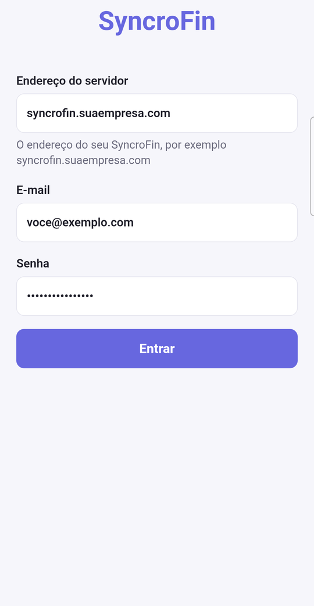
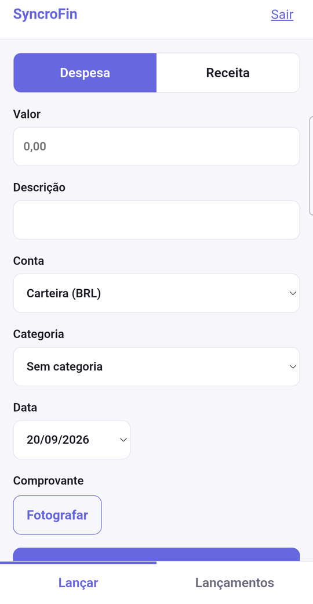
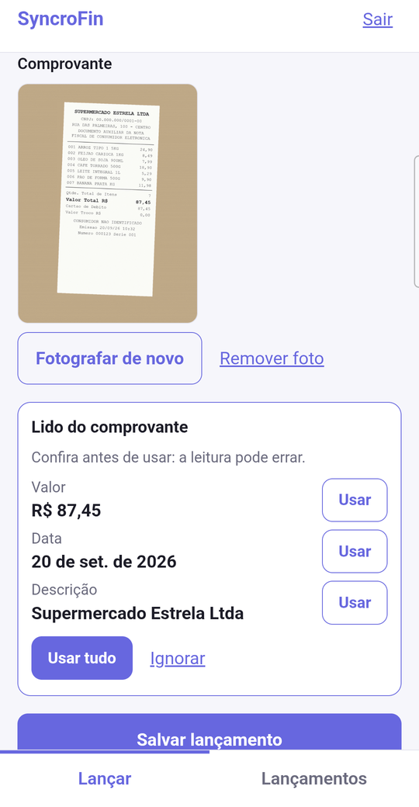
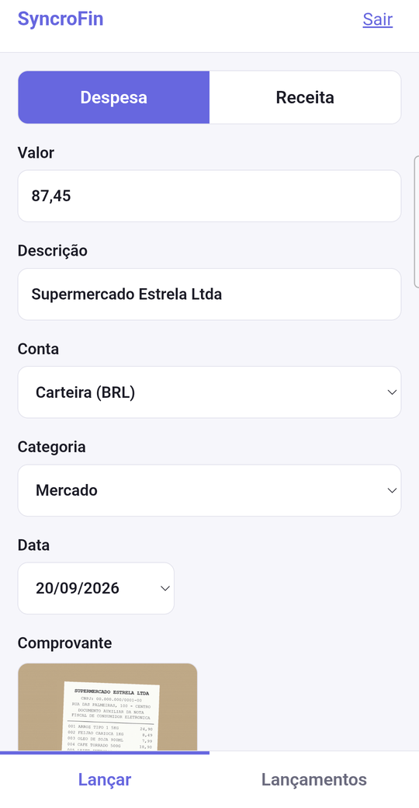
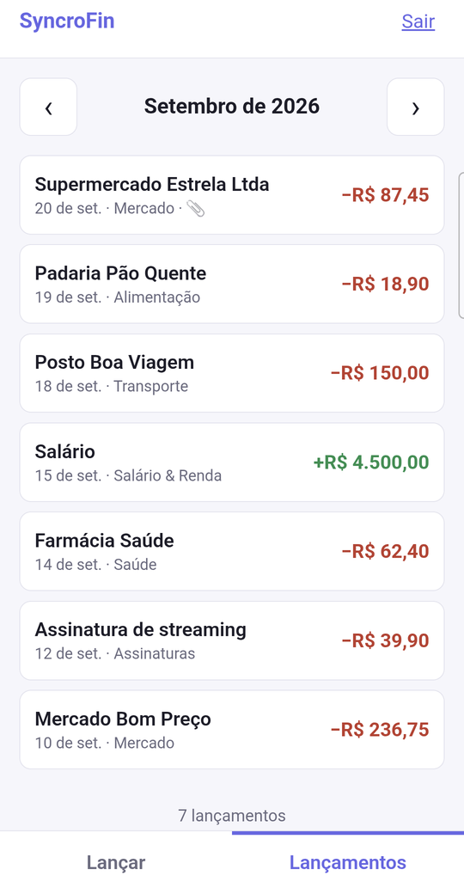
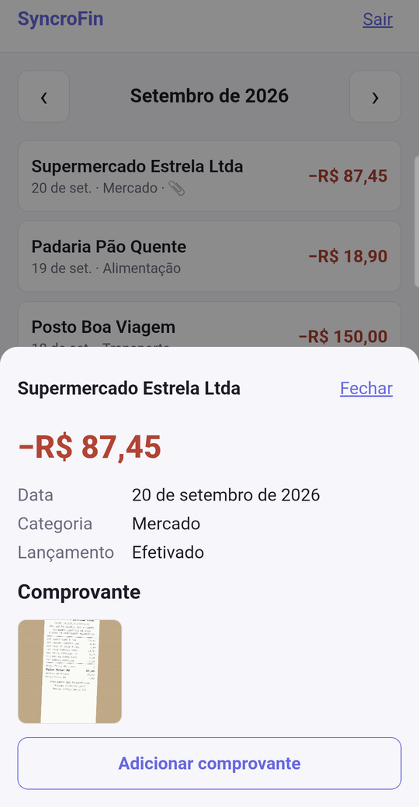

<!-- Gerado por `npm run manual:build` (frontend/). Não edite: edite as páginas em
     frontend/src/help/content/pt-BR/ e gere de novo. -->

# Manual do SyncroFin

O mesmo conteúdo da ajuda dentro do sistema (botão **?** em cada tela), em um só arquivo.

<a id="indice"></a>

## Índice

**Primeiros passos**

- [Introdução ao SyncroFin](#introducao)
- [Primeiros passos: acesso e conta](#primeiros-passos)
- [Navegação e atalhos](#navegacao)

**Uso diário**

- [Painel](#painel)
- [Transações](#transacoes)
- [Contas](#contas)
- [Importar](#importar)

**Organização**

- [Categorias](#categorias)
- [Centros de Custo](#centros-de-custo)
- [Provisões e diferimentos](#provisoes)
- [Regras](#regras)
- [Coleções](#colecoes)
- [Pessoas](#pessoas)

**Planejamento e análises**

- [Orçamentos](#orcamentos)
- [Metas](#metas)
- [Recorrentes](#recorrentes)
- [Patrimônio](#patrimonio)
- [Relatórios](#relatorios)
- [DRE e Fluxo de Caixa](#dre)
- [Saúde financeira e previsão de caixa](#saude-financeira)
- [Consolidado Multiempresa](#consolidated)

**Negócios**

- [Grupos (divisão de despesas)](#grupos)
- [Cobranças](#cobrancas)
- [Emissão de NF-e](#emissao-nfe)
- [Cobrança por Boleto e PIX](#boleto-pix)
- [Títulos](#titulos)
- [Pagamentos (PIX e TED)](#pagamentos)
- [Conciliação](#conciliacao)
- [Exportar para o contador](#contador)
- [Obrigações Fiscais e Retenções](#obrigacoes-fiscais)
- [Retenção Documental Fiscal](#retencao-documental)

**Conta e workspace**

- [Retenção de dados](#retencao-dados)
- [Configuração inicial da empresa](#onboarding-empresa)
- [Workspace](#workspace)
- [Auditoria](#auditoria)
- [Segurança e conta](#seguranca-conta)
- [Notificações](#notificacoes)
- [Usar no celular](#app-celular)

**Administração**

- [Administração](#administracao)
- [Publicar com HTTPS](#publicar-https)
- [Tokens de API](#tokens-api)
- [Agentes de IA](#agentes)
- [Períodos](#periods)
- [Aprovações](#approvals)
- [Webhooks](#webhooks)
- [Conectores ERP](#conectores-erp)

**Referência**

- [Perguntas frequentes e solução de problemas](#faq)

---

<a id="introducao"></a>

## Introdução ao SyncroFin

O **SyncroFin** é um gestor financeiro que roda na *sua* infraestrutura: seus dados ficam no seu servidor, sem
depender de terceiros. Serve para controlar as finanças pessoais, de uma família ou de uma pequena empresa, em um
só lugar.

> **Como usar este manual.** Em qualquer tela, pressione **?** (ou **F1**), ou clique no botão redondo de
> interrogação no canto inferior direito: abre a ajuda **daquela tela**. O link *Abrir o manual completo* leva a
> este manual inteiro, com busca.

Primeira vez aqui? Comece por [Primeiros passos](#primeiros-passos): como entrar, criar a conta e aceitar um
convite.

### O que dá para fazer

- Registrar e categorizar receitas e despesas, à mão, por **importação de extratos** ou por **sincronização
  bancária** ([Transações](#transacoes), [Importar](#importar), [Contas](#contas)).
- Acompanhar orçamentos, metas, contas recorrentes e o patrimônio ([Orçamentos](#orcamentos),
  [Metas](#metas), [Recorrentes](#recorrentes), [Patrimônio](#patrimonio)).
- Ver tudo em relatórios e em um painel com **nota de saúde financeira** e **previsão de caixa**
  ([Painel](#painel), [Relatórios](#relatorios)).
- Dividir despesas com outras pessoas ([Grupos](#grupos)) e, em um workspace de negócio, cobrar clientes e
  acompanhar o que entrou ([Cobranças](#cobrancas)).
- Entregar ao contador um pacote pronto para planilha ([Exportar para o contador](#contador)).

### Conceitos que aparecem em todo o sistema

| Conceito | O que é |
|----------|---------|
| **Workspace** | Um "cofre" independente: tem as próprias contas, categorias, orçamentos, metas e membros. Você começa com um workspace **Pessoal** e pode criar outros (por exemplo, o da sua empresa). Nada vaza de um para outro. Veja [Workspace](#workspace). |
| **Tipo do workspace** | **Pessoal** ou **Negócios**. O tipo é definido ao criar e **não muda depois**. Workspaces de negócio ganham o módulo **Cobranças**. |
| **Papéis** | **Dono** (tudo, inclusive membros), **Editor** (lê e escreve dados), **Leitor** (só leitura) e **Gerente** (administrador externo, com direitos de dono). |
| **Conta** | Onde o dinheiro está: conta corrente, poupança, cartão de crédito, investimento ou carteira. Pode ser **manual** ou **conectada** a um banco. |
| **Transação** | Um lançamento: valor, data, descrição, categoria, conta. É **Receita** (entrada) ou **Despesa** (saída). |
| **Categoria** | Rótulo do gasto ou da receita (Alimentação, Transporte…). Alimenta orçamentos e relatórios. |
| **Transferência** | Dinheiro que muda de uma conta sua para outra. **Não conta** como receita nem despesa. |
| **Módulo** | Cada seção do menu (Transações, Contas, Orçamentos…). Quais aparecem depende do tipo do workspace. |

### Moeda e formatos

Cada workspace tem uma **moeda padrão**. Valores em outras moedas são convertidos automaticamente para ela
(veja [Transações](#transacoes), *Moedas diferentes*). O formato de números e datas é definido pelo
administrador ([Administração](#administracao)).

### Onde ficam as coisas

- **Menu lateral:** as seções do dia a dia (veja [Navegação e atalhos](#navegacao)).
- **Menu da conta** (rodapé do menu lateral): trocar de workspace, senha, segurança, backup, exportar para o
  contador, idioma e sair ([Segurança da conta](#seguranca-conta)).
- **Sino:** avisos como orçamento estourado e fatura vencendo ([Notificações](#notificacoes)).

### Idiomas

A interface está em **Português (BR)**, **English** e **Español**. Troque no menu da conta → *Idioma*.

---

<a id="primeiros-passos"></a>

## Primeiros passos: acesso e conta

Esta página cobre as telas de **entrada**: primeiro acesso, login, criação de conta e recuperação de senha.

### Primeiro acesso: criar o administrador

Numa instalação nova, ao abrir o endereço do sistema aparece **Bem-vindo ao SyncroFin**. Informe:

1. **Seu nome** (como devemos te chamar), **e-mail** e **senha** (mínimo de 8 caracteres) com **confirmação**.
2. **Idioma**, **Tema** e **Moeda** (a moeda do seu workspace Pessoal).
3. Clique em **Criar Conta Admin**.

Essa tela só funciona **uma vez**, enquanto não existe nenhum usuário. A conta criada é a **administradora** da
instalação ([Administração](#administracao)).

### Entrar

Na tela **Entrar**, use:

- **E-mail e senha**, ou
- **Continuar com chave de acesso** (passkey): Touch ID, Face ID, Windows Hello ou chave de segurança, sem digitar
  senha. Veja [Segurança da conta](#seguranca-conta) para cadastrar;
- **Login único (SSO)**, quando o administrador configurou um provedor (Authentik, Pocket ID etc.). Aparece um botão
  com o nome do provedor. Se a instalação for *somente SSO*, os campos de senha não aparecem.

Se você ativou a **autenticação em dois fatores**, depois da senha o sistema pede o **código de 6 dígitos** do
seu aplicativo autenticador (ou uma chave de segurança). Um código inválido é recusado; após várias tentativas
erradas o acesso é temporariamente limitado.

> **Chaves de acesso só funcionam** em `http://localhost` ou em um endereço com **HTTPS e domínio**. Não funcionam
> em endereço por IP (por exemplo `http://192.168.0.10`), por uma regra do próprio navegador.

### Criar conta

O link **Criar conta** aparece se o administrador permitiu o registro. Informe e-mail, senha, confirmação e a
**moeda**. Cada nova conta ganha um workspace Pessoal com categorias e regras padrão.

Se o link não aparece, o registro está desativado: peça a um administrador para criar seu usuário ou para
**convidar você** para um workspace.

### Esqueci a senha

1. Na tela **Entrar**, clique em **Esqueceu a senha?**.
2. Informe seu e-mail e clique em **Enviar link de redefinição**.
3. Abra o e-mail que chega e clique no link. Ele leva a **Escolha uma nova senha**.
4. Digite a nova senha duas vezes e clique em **Salvar senha**.

Detalhes importantes:

- O link vale **1 hora** e funciona **uma única vez**. Depois de usado (ou se você trocar a senha por outro meio),
  ele deixa de valer; peça outro.
- A resposta é a **mesma** para e-mails cadastrados ou não: por segurança, o sistema nunca revela quem tem conta.
  Se nada chegar, confira o spam e o endereço digitado.
- Se aparecer *"Esta instalação não consegue enviar e-mails"*, o servidor não tem e-mail configurado: peça ao
  administrador para redefinir sua senha em **Administração → Usuários**.

### Fui convidado para um workspace

Quando um dono convida você **sem definir uma senha**, chega um e-mail com um link (válido por **7 dias**, uso único).
Ele abre a tela **Bem-vindo ao SyncroFin**, onde você **escolhe sua própria senha**. Depois é só entrar.

Se você já tinha conta, o e-mail apenas avisa que foi adicionado; o workspace aparece no seletor de workspaces.

### Problemas para entrar?

Veja [Perguntas frequentes e solução de problemas](#faq).

---

<a id="navegacao"></a>

## Navegação e atalhos

### Menu lateral

O menu lateral tem as seções, agrupadas. O que aparece depende do **tipo do workspace** e do seu papel.

| Grupo | Itens |
|-------|-------|
| **Contas** | [Transações](#transacoes), [Cobranças](#cobrancas) (só em workspace de negócio), [Contas](#contas), [Importar](#importar) |
| **Análise** | [Relatórios](#relatorios), [Patrimônio](#patrimonio) |
| **Configuração** | [Orçamentos](#orcamentos), [Metas](#metas), [Recorrentes](#recorrentes), [Categorias](#categorias), [Pessoas](#pessoas), [Grupos](#grupos), [Regras](#regras) |

O nome **SyncroFin** no topo do menu leva de volta ao [Painel](#painel). No celular, o menu abre pelo botão de
menu no canto superior.

### Paleta de comandos

Pressione **Ctrl + K** (**⌘ + K** no Mac) ou clique em **Buscar em tudo…**. Digite para procurar transações, contas,
pessoas, categorias, metas e ativos, ou use as **ações rápidas**: *Nova transação*, *Importar CSV / OFX / QIF*, *Nova
meta*, *Novo orçamento*, *Abrir relatórios*. Use as setas para navegar, **Enter** para abrir e **Esc** para fechar.

### Ícones do topo do menu

- **Sino**: avisos ([Notificações](#notificacoes)).
- **Olho**: **Ocultar valores** (modo privacidade). Esconde os valores na tela, útil para compartilhar a tela ou
  usar em público. Clique de novo para mostrar.
- **Sol/lua**: alterna entre tema claro e escuro.
- **Robô**: abre o chat com os **agentes de IA**, quando o recurso está ligado ([Agentes de IA](#agentes));
  atalho **Ctrl + J**.

### Menu da conta e workspaces

No rodapé do menu lateral fica o nome do workspace atual. Ao clicar você acessa:

- **Trocar de workspace** e **Novo workspace** ([Workspace](#workspace)).
- **Configurações do workspace**.
- Alterar senha, autenticação em dois fatores, chaves de acesso, **Backup** e **Exportar para o contador**
  ([Segurança da conta](#seguranca-conta), [Exportar para o contador](#contador)).
- **Idioma**.
- **Administração** (somente administradores).
- **Sair**.

Também mostra a **versão** em execução e avisa quando existe uma versão nova.

### Filtro por coleção

Se você criou [Coleções](#colecoes), um seletor permite ver o painel e as telas apenas com as contas de uma
coleção.

### Tour de boas-vindas

No primeiro acesso, um **tour** de 6 passos apresenta o menu, o painel, contas, transações, importação e categorias.
Use **Próximo**, **Voltar** ou **Pular tour**.

### Atalhos de teclado

| Atalho | O que faz |
|--------|-----------|
| **?** ou **F1** | Abre a ajuda da tela atual (não funciona enquanto você digita em um campo) |
| **Ctrl/⌘ + K** | Paleta de comandos |
| **Ctrl/⌘ + J** | Chat com agentes de IA (quando ativo) |
| **Esc** | Fecha diálogos, painéis e menus |

### Instalar como aplicativo

No celular Android há um **app próprio**, simples, para lançar movimentos e **fotografar o comprovante** (com leitura de valor, data e
estabelecimento). O sistema completo também pode ser instalado como **aplicativo web (PWA)**: no Chrome/Edge, pelo ícone de instalação da
barra de endereço; no iPhone, por *Adicionar à Tela de Início*. Em qualquer caso o endereço precisa ser **HTTPS**, e **sem internet** os
dados financeiros **não** ficam guardados no aparelho.

Passo a passo, com as telas do app: [Usar no celular](#app-celular).

---

<a id="painel"></a>

## Painel

O **Painel** é a tela inicial: um resumo do mês escolhido, com saldos, gastos, tendências e alertas. Você chega
nele ao clicar no nome **SyncroFin** do menu lateral.

### Escolher o período

No topo, o seletor de mês (**‹ Setembro de 2026 ›**) muda o mês exibido. Clique no nome do mês para abrir um
calendário de meses. Se você usa [Coleções](#colecoes), o filtro de coleção limita tudo às contas dela.

### Cartões de resumo

| Cartão | Significado |
|--------|-------------|
| **Saldo disponível em contas** | Soma dos saldos das suas contas, com o detalhamento por conta (e por moeda, se houver mais de uma). |
| **Entradas do Mês** / **Saídas do Mês** | Receitas e despesas **efetivadas** no mês. Transferências entre suas contas **não** entram. |
| **Saídas previstas** / **Entradas previstas** | O que ainda deve acontecer no mês, vindo das [Recorrentes](#recorrentes). |
| **Patrimônio líquido** | Contas + investimentos, descontadas as faturas de cartão em aberto. |
| **Taxa de Economia** | Quanto da renda do mês ficou guardada. Quando não há renda no mês, aparece `---`. |
| **Nesse ritmo, você gastará…** | Projeção do gasto até o fim do mês, pelo ritmo até agora. |

Se houver **grupos de divisão de despesas**, o patrimônio mostra também o líquido depois do que você deve ou tem a
receber ([Grupos](#grupos)).

### Transações sem categoria

Quando existem transações sem categoria, uma faixa amarela avisa: *"N transações precisam ser categorizadas"*.
**Categorizar agora** leva à lista já filtrada. Quando tudo está categorizado, aparece **Tudo em dia!**

### Saúde financeira e previsão de caixa

Um cartão mostra a **nota de saúde financeira** (0 a 100) e a **previsão de caixa** dos próximos 90 dias. Explicação
completa em [Saúde financeira e previsão de caixa](#saude-financeira).

### Gráficos

- **Gastos por Categoria:** barras com o quanto foi gasto em cada categoria no mês. Ordene por **Maior gasto** ou
  **Menor gasto**. Clique numa categoria para ver as transações dela (*drill-down*).
- **Tendência Mensal:** receitas e despesas dos últimos meses.
- **Orçamento vs Realizado:** cada categoria com orçamento, com o quanto do limite foi usado
  ([Orçamentos](#orcamentos)).
- **Fluxo de Saldo:** a evolução do saldo dia a dia, comparada ao mês anterior. Passe o mouse para ver o saldo de
  cada dia.
- **Progresso das Metas:** as suas [Metas](#metas) e o quanto falta.
- **Transações Recentes / do Período:** as últimas movimentações, com ordenação.

Clicar em um valor de entrada ou saída abre a lista de transações que o compõem, com o total (*Liquidado* e
*Pendente de liquidação*).

### Regime de caixa e de competência

Compras no **cartão de crédito** podem contar de duas formas, definidas pelo administrador
([Administração](#administracao)):

- **Regime de caixa** (padrão): a compra conta no dia em que aconteceu;
- **Regime de competência:** a compra conta na **data de vencimento da fatura**. Nesse modo o painel mostra uma nota
  explicando.

### Atualizar as taxas de câmbio

Se você tem transações em outras moedas, o painel mostra o **detalhamento por moeda** e permite **atualizar as taxas
de câmbio**. Sem uma chave de câmbio configurada, o sistema usa **1:1** e avisa.

### Dicas

- **Ocultar valores** (ícone de olho) esconde todos os números da tela.
- O painel do workspace **Pessoal** e o do de **Negócios** são independentes.

---

<a id="transacoes"></a>

## Transações

Em **Transações** ficam todos os lançamentos do workspace. Você navega mês a mês, busca, filtra, edita e faz ações em
lote.

### Duas visões

No topo, alterne entre **Lista** e **Calendário**.

- **Lista:** uma linha por transação, com data, descrição, categoria, conta, valor e status.
- **Calendário:** os dias do mês com a atividade de cada um. Escolha ver o **Saldo** ou a **Atividade**; o modo
  **Compacto** ou **Detalhado**; e o número de contas. Clique em um dia para ver as transações e para
  **Adicionar receita** ou **Adicionar despesa** naquela data. Transações **previstas** (de [Recorrentes](#recorrentes))
  aparecem identificadas.

### Criar uma transação

Clique em **Adicionar Transação** e preencha:

| Campo | Observação |
|-------|------------|
| **Tipo** | **Despesa** (saída) ou **Receita** (entrada). |
| **Descrição** | Texto livre. |
| **Valor** e **Moeda** | Se a moeda for diferente da conta, veja *Moedas diferentes* abaixo. |
| **Data** | Quando aconteceu. |
| **Conta** | Onde o dinheiro entrou ou saiu. |
| **Categoria** | Opcional, mas importante para orçamentos e relatórios. |
| **Pessoa** | Quem pagou ou recebeu ([Pessoas](#pessoas)). |
| **Notas** | Texto livre. Use **#tags** (por exemplo `#trabalho #reembolsável`) para marcar. |
| **Anexos** | Arraste arquivos ou clique. Aceita jpg, jpeg, png, webp, gif, heic e pdf, **até 10 MB** cada, com um limite de anexos por transação. |

O botão de salvar tem variações em **Mais opções de salvar**: **Salvar e novo** (limpa e abre outra) e **Salvar e
duplicar** (mantém os dados para você ajustar). Em qualquer linha, **Duplicar** cria uma cópia.

#### Repetir em parcelas

Marque **Repetir em parcelas** para lançar uma compra parcelada: informe o **número de parcelas** e a
**frequência**. O sistema cria a série. Ao **editar ou excluir** uma parcela, ele pergunta **até onde aplicar**:
**Apenas esta**, **Esta e as futuras** ou **Todas as parcelas**.

#### Tornar recorrente

**Tornar recorrente** cria uma [conta recorrente](#recorrentes) a partir da transação, para que ela se repita
automaticamente.

#### Moedas diferentes

Se a moeda da transação difere da moeda do workspace, o valor é **convertido automaticamente** pela taxa do dia. Você
pode preencher **Convertido** e **Taxa de câmbio** à mão. Se aparecer *"Taxa de câmbio indisponível — usando fallback
1:1"*, o sistema não conseguiu uma taxa: defina manualmente ou peça ao administrador para configurar o provedor de
câmbio.

### Status: Pendente e Lançada

Transações **Pendentes** ainda não foram compensadas pelo banco. As **Lançadas** já foram. Você pode ocultar ou
mostrar pendentes nos filtros.

### Transações sincronizadas

Transações que vieram de uma **conexão bancária** são "sincronizadas": nelas só é possível editar **categoria e
notas**. O restante vem do banco e é mantido por ele.

### Busca, filtros e colunas

- **Buscar transações…** procura na descrição.
- **Filtros:** por **Data** (Hoje, Últimos 7/30/90 dias, Este mês, Este ano ou **Período personalizado**), **Valor**
  (mínimo e máximo; o mesmo valor nos dois busca o valor exato), **Categoria**, **Conta**, **Pessoa**, **Tipo** e
  **Status**. **Limpar filtros** volta ao padrão.
- **Colunas:** escolha quais colunas mostrar (Data, Descrição, Categoria, Conta, Valor, Pessoa, Notas, Tags,
  Arquivos, Tipo, Status). **Restaurar padrão** desfaz.
- **Ocultar ignoradas:** esconde as transações ignoradas (veja adiante).
- **Exportar CSV:** baixa as transações filtradas (ou só as selecionadas: **Exportar Selecionadas**).

### Ações em lote

Marque transações pela caixa da esquerda. Aparece uma barra com:

- **Aplicar** uma **categoria** a todas;
- **Adicionar tags** / **Remover tags**;
- **Adicionar ao grupo** (dividir despesas: [Grupos](#grupos));
- **Vincular como transferência** (com exatamente **2** selecionadas);
- **Excluir selecionadas** (**definitivo**, inclusive contrapartes de transferência e anexos).

### Categorizar e criar regras

Ao categorizar uma transação, o menu oferece **Criar Regra**: cria uma [regra](#regras) para que transações
parecidas sejam categorizadas sozinhas no futuro. Também há **Adicionar a regra existente**, que soma a descrição a
uma regra que você já tem.

### Transferências entre contas

Uma transferência é dinheiro que sai de uma conta sua e entra em outra.

- **Criar:** use **Transferência** (conta de origem, de destino, valor, descrição). Se as moedas forem diferentes,
  informe o valor de destino ou deixe em branco para converter.
- **Vincular duas transações já existentes:** selecione as duas (um débito e um crédito, de contas diferentes) e use
  **Vincular como transferência**; ou, a partir de uma delas, o assistente sugere a **Melhor correspondência** pela
  data e valor. Se a contraparte for uma conta manual e ainda não existir, ele pode **criá-la**.
- **Efeito:** transferências **não entram** em receitas e despesas de relatórios e do painel. Editar ou excluir um
  lado afeta o outro. **Desvincular transferência** devolve as duas ao normal.

### Ignorar e excluir dos relatórios

| Opção | Efeito |
|-------|--------|
| **Ignorar** | A transação **some dos totais** e do saldo da conta. Fica guardada e pode ser reativada (**Não ignorar**). |
| **Excluir dos relatórios** | Continua **afetando o saldo** da conta, mas **não conta** como receita ou despesa. Útil para ajustes de saldo. |

### Faturas de cartão de crédito

Em contas de cartão, uma compra pode ser movida para outra fatura definindo a **Data efetiva da fatura**
(manual, sobrescreve o ciclo automático). Veja [Contas](#contas).

### Ligação com Cobranças

Em workspaces de negócio, uma transação que quita uma cobrança mostra uma etiqueta **Cobrança nº…**. Uma etiqueta
**Pergunta** indica que um pagamento pode quitar uma cobrança e espera sua resposta ([Conciliação](#conciliacao)).

### Excluir uma transação

Pelo menu da linha ou dentro da transação. O sistema pede confirmação. Se ela é uma parcela, pergunta o escopo.

---

<a id="contas"></a>

## Contas

Em **Contas** você cadastra onde seu dinheiro está e conecta bancos para importar tudo automaticamente.

### Contas manuais e conexões bancárias

A tela tem duas áreas:

- **Contas Manuais:** contas que você mesmo alimenta (lançando transações ou [importando extratos](#importar)).
- **Conexões Bancárias:** contas trazidas de um banco por **sincronização**. Cada conexão mostra a instituição, as
  contas dela e a **última sincronização**.

Contas **encerradas** ficam em uma área própria (**Contas Encerradas**) e saem dos totais.

### Tipos de conta

**Conta Corrente**, **Poupança**, **Cartão de Crédito**, **Investimento** e **Carteira** (dinheiro em espécie).

### Criar uma conta manual

Clique em **Adicionar Conta**:

| Campo | Observação |
|-------|------------|
| **Nome da conta** | Como aparece no sistema. |
| **Tipo** | Veja acima. |
| **Moeda** | Moeda da conta. |
| **Saldo** | Saldo inicial (o "saldo inicial" vira um lançamento de abertura). Em **cartão de crédito**, o campo é **Valor devido**: informe quanto você deve hoje, como número positivo. |
| **Data do saldo** | Data a que o saldo se refere. |

Para editar, use **Editar Conta**. O **Nome de exibição** substitui o nome que o banco informa, em todo o sistema.

### Cartão de crédito

Para cartões, preencha (são opcionais, mas ativam recursos):

- **Limite do cartão**, **Dia de fechamento** e **Dia de vencimento** (dia do mês, 1 a 31);
- **Mínimo** da fatura.

Com isso, a tela da conta mostra por **ciclo de fatura**: **Total da fatura**, **Compras**, **Pagamentos**,
**Limite disponível**, **Utilização**, o **Vencimento** e alertas (*Vence hoje*, *Vence em N dias*, *Atrasado*).
Navegue entre **Ciclo anterior** e **Próximo ciclo**. Sem os dias de fechamento e vencimento aparece
**Configurar ciclo**: eles ativam filtros por fatura, alertas de vencimento e o enquadramento correto das compras.

### Detalhe de uma conta

Clique em uma conta para ver: **Saldo atual**, **Entradas**, **Saídas**, **Saldo projetado** e as transações da
conta, com o **saldo corrente** linha a linha. **Ver transações** abre a lista filtrada por essa conta.

### Conectar um banco

Clique em **Conectar Banco** e escolha o **conector**. Só aparecem os que o administrador configurou.

| Conector | Para quê | Como conecta |
|----------|----------|--------------|
| **Pluggy** | Bancos brasileiros (Open Finance) | Abre o widget do Pluggy dentro do sistema: escolha o banco e autorize. |
| **Enable Banking** | Bancos europeus (PSD2) | Você escolhe o **país** e o **banco**; é redirecionado ao banco para autorizar e volta ao sistema. |
| **SimpleFIN** | Bancos dos EUA e internacionais | Gere um **token de configuração** no SimpleFIN Bridge e **cole** aqui (uso único). |

Antes de abrir o conector, **Opções de sincronização** permitem decidir o que importar (por exemplo,
**Importar transações pendentes** e **Importar ativos de investimento**). Depois da autorização, o sistema
importa contas, saldos e transações; pode levar um minuto. **Não feche a aba** enquanto isso.

> No **Enable Banking em modo restrito (plano gratuito)**, as contas precisam ser vinculadas no portal do
> provedor *antes*. Se nenhuma conta aparecer, o sistema mostra **Contas ainda não vinculadas** com um botão para
> abrir o portal e outro para tentar novamente.

#### Configurações da conexão

Em **Configurações da conexão** você define o **Apelido**, a **Origem da pessoa** (de onde tirar o nome de quem
pagou/recebeu: comerciante, dados de pagamento, descrição, automático ou nenhuma) e se importa transações
pendentes ou ativos de investimento.

#### Sincronizar, reconectar e desconectar

- **Sincronizar:** força uma atualização agora. O sistema também sincroniza sozinho, de hora em hora.
- **Reconectar:** aparece quando a conexão **expirou** ou deu erro (*"Conexão expirada — reconecte para corrigir"*).
  Você é levado a autorizar de novo, **sem perder** o histórico. Quando a autorização do banco expira, um aviso
  aparece no sino ([Notificações](#notificacoes)).
- **Desconectar:** remove a conexão **e as contas e transações sincronizadas** dela. É irreversível.

### Encerrar e excluir

- **Encerrar conta:** esconde a conta dos totais e, se for conectada, interrompe a sincronização. Dá para
  **Reabrir conta**.
- **Excluir conta:** remove também **todas as transações e registros de importação**. **Irreversível.**

### Contas de crédito compartilhadas

Se várias contas compartilham a mesma linha de crédito, o saldo aparece como **Linha de crédito compartilhada**.

### Saldos e o que "saldo" significa

Numa conta **manual**, o saldo é a soma das transações (incluindo o lançamento de abertura). Numa conta
**conectada**, vale o valor informado pelo banco, para bater com o aplicativo dele.

---

<a id="importar"></a>

## Importar

**Importar** traz transações (e ordens de investimento) de arquivos, sem digitar. É o caminho para bancos que não
têm sincronização.

### Formatos aceitos

**OFX**, **QIF**, **CAMT** (extrato bancário europeu), **CSV** e **CNAB** (240/400). A tela tem três abas:
**Transações**, **Investimentos** e **NF-e XML**.

### Importar transações

1. Arraste o arquivo para a área **Arraste um arquivo ou clique para selecionar** (ou clique e escolha).
2. O sistema lê o arquivo e mostra a **Pré-visualização**, com o número de receitas e despesas encontradas.
3. Escolha a conta em **Importar para:** (obrigatório).
4. Revise a lista. Você pode **buscar**, filtrar por **categoria** ou **status**, e **excluir linhas** que não quer
   (uma linha excluída aparece como *Excluída*). Categorias podem ser ajustadas na própria pré-visualização;
   quando uma regra sugere uma, aparece **Sugerida**.
5. Confira o **Impacto no saldo** e clique em **Importar N transações**.

Ao terminar, o sistema informa quantas foram importadas, quantas eram **duplicadas** (e foram ignoradas) e quantas
você excluiu.

#### Opções (principalmente para CSV)

| Opção | O que faz |
|-------|-----------|
| **Formato da data** | *Automático (detectar)* ou um formato fixo. |
| **Inverter valores** | Troca entrada e saída (alguns bancos exportam o sinal ao contrário). |
| **Ignorar transações duplicadas** | Não importa de novo o que já existe. Ligado por padrão. |
| **Separar colunas entrada/saída** | Para arquivos com uma coluna de crédito e outra de débito: aponte a **Coluna de entrada** e a **Coluna de saída**. |

#### Mapeamento de colunas

Se o sistema **não reconhece as colunas** do CSV, aparece **Mapeamento de colunas**: associe cada coluna do seu arquivo
aos campos do SyncroFin (**data**, **descrição**, **valor**, **tipo**, **categoria**, **moeda**, **câmbio**,
**pessoa**, **ID da transação**, **notas**). Deixe em *Detectar automaticamente* para manter a detecção. Data, descrição
e valor são o mínimo.

Se algumas linhas **não puderam ser lidas** (data ou valor inválidos), o sistema avisa e **Ver detalhes** mostra a linha,
o valor e o motivo. Elas são ignoradas.

**Baixar modelo CSV** entrega um arquivo de exemplo com as colunas esperadas.

### Histórico de Importações

Abaixo, o **Histórico de Importações** lista cada importação: data, arquivo, formato, conta, quantidade e totais de
crédito e débito. Em cada uma você pode **Desfazer importação**, que **exclui as transações daquele arquivo**. Não
dá para desfazer o desfazer.

### Importar investimentos

Na aba **Investimentos** (ou pelo botão **Importar ordens** em [Patrimônio](#patrimonio)):

- Use um CSV com **Ativo** (código), **Data**, **Quantidade** e **Preço** (obrigatórios); **Taxas**, **Compra/Venda**,
  **Moeda** e **Observações** são opcionais. **Quantidade negativa** é lida como **venda**.
- Escolha a **Carteira** de destino. Se o ativo já existe em outra carteira, o sistema **avisa** antes de criar uma
  segunda posição.
- A pré-visualização mostra ordens prontas, ativos criados/encontrados e ordens **já importadas** (que são
  puladas). Linhas com problema mostram o motivo: *sem ativo*, *data ilegível*, *quantidade ilegível*, *preço
  ilegível*, *ativo não encontrado no provedor de cotações* ou *venda maior do que a posição*.
- **Baixar modelo** entrega o CSV de exemplo.

### Importar NF-e XML (nota fiscal de fornecedor)

Na aba **NF-e XML** você importa o arquivo XML emitido pelo seu fornecedor. O sistema lê a nota
e cria um **título a pagar** (contas a pagar) automaticamente.

1. Arraste o arquivo `.xml` da NF-e (envelope `nfeProc` ou `NFe`) para a área de importação.
2. O sistema mostra a **Prévia**: emitente, CNPJ, número, valor total, tributos e itens.
3. Informe a **Data de vencimento** do pagamento.
4. Clique em **Criar título a pagar**.

A nota é identificada pela **chave de acesso** (44 dígitos): reimportar o mesmo arquivo é
**idempotente** e retorna o título já existente sem duplicar.

> Somente NF-e modelo 55. NFS-e municipal não é suportada aqui.

### Extrato CNAB

Os arquivos **CNAB 240** e **CNAB 400** (extensão `.cnab`, `.rem` ou `.ret`) são detectados
automaticamente na aba **Transações**, junto com OFX e CSV. Arraste o arquivo normalmente —
o sistema detecta o formato pelo comprimento de linha.

### Dicas

- Sempre escolha a conta certa antes de importar; para desfazer, use o histórico.
- Importações e regras trabalham juntas: transações importadas passam pelas suas [regras](#regras) e já saem
  categorizadas quando há correspondência.
- Para ver os títulos a pagar criados via NF-e, acesse [Contas a Pagar/Receber](#titulos).

---

<a id="categorias"></a>

## Categorias

**Categorias** classificam receitas e despesas. É por elas que os orçamentos, os relatórios e o gráfico *Gastos por
Categoria* funcionam.

### Categorias e grupos

- Uma **categoria** tem nome, **ícone** e **cor**.
- Categorias podem ser organizadas em **grupos** (por exemplo, "Moradia" reunindo Aluguel, Condomínio e Luz).
  Uma categoria pode ficar **Sem grupo**. Use **Expandir tudo** / **Recolher tudo** para navegar.

Ao criar um workspace, ele já vem com **categorias e grupos padrão** (você pode ocultá-los ou editá-los).

### Criar, editar e excluir

- **Adicionar Categoria:** informe nome, grupo, ícone e cor.
- **Adicionar Grupo:** grupos têm nome, ícone, cor e **posição** (a ordem na lista).
- **Excluir:** uma categoria **em uso** por transações, regras ou orçamentos não pode ser excluída até que
  esses registros sejam ajustados (*"Esta categoria ainda está em uso"*). Excluir um **grupo** mantém as categorias
  dele, que passam a ficar sem grupo.

### Ocultar categorias padrão

Categorias e grupos **padrão** podem ser **ocultados** em vez de excluídos: deixam de aparecer nos seletores e não
são mais atribuídos automaticamente. Se regras ativas usam a categoria, o sistema avisa e pergunta se você quer
**Apenas ocultar** ou **Ocultar e desligar as regras**. Dá para **Mostrar** de novo depois.

### Tratamento especial

Duas opções mudam como as transações de uma categoria contam nos relatórios:

| Opção | Efeito |
|-------|--------|
| **Tratar como transferência** | As transações da categoria **não contam** como receita nem despesa. Serve para movimentos que trocam de lugar, como **aplicar em um investimento** (a contrapartida está em [Patrimônio](#patrimonio), não em uma conta). |
| **Ignorar transações** | As transações da categoria são tratadas como se não existissem nos cálculos de receita e despesa. |

Categorias marcadas mostram uma etiqueta (*Transferência* ou *Ignorado*).

### Dicas

- Poucas categorias bem escolhidas rendem relatórios melhores que dezenas de categorias quase iguais.
- Crie [regras](#regras) para categorizar automaticamente o que se repete.
- Categorizar em lote: em [Transações](#transacoes), selecione várias e use **Aplicar**.
- Para classificar lançamentos por departamento ou projeto sem alterar o plano de contas, use [Centros de Custo](#centros-de-custo).

---

<a id="centros-de-custo"></a>

## Centros de Custo

**Centros de Custo** permitem criar dimensões opcionais para classificar seus lançamentos por
departamento, projeto ou área (ex.: Marketing, Operações, Financeiro). Use-os quando precisar
analisar gastos ou receitas por unidade de negócio sem alterar o plano de contas.

### Criar um centro de custo

Clique em **Novo centro de custo** e preencha:

- **Nome** — obrigatório; ex.: "Marketing"
- **Código** — opcional; sigla curta para filtros e exportação (ex.: "MKT")
- **Descrição** — opcional; anotação interna sobre o propósito do centro

Após salvar, o centro aparece na lista e fica disponível para ser vinculado a lançamentos.

### Usar em lançamentos

No formulário de cadastro ou edição de um lançamento, o campo **Centro de custo** exibe os
centros ativos do workspace. Basta selecionar o desejado. Deixe em branco (ou selecione
"(nenhum)") quando o lançamento não pertencer a nenhum centro específico.

### Editar um centro de custo

Clique no ícone de lápis ao lado do centro. Você pode alterar o nome, o código e a descrição.
Centros desativados podem ser reativados marcando a opção **Ativo** no formulário de edição.

### Desativar e excluir

Clique no ícone de lixeira ao lado do centro. O comportamento depende do uso:

- **Excluir** — remove permanentemente se o centro não tiver lançamentos associados.
- **Desativar** — se houver lançamentos vinculados, o centro é desativado automaticamente.
  Ele fica invisível em novos lançamentos, mas continua preservado nos registros históricos
  para manter a integridade dos dados passados.

### Boas práticas

- Mantenha os códigos curtos e padronizados (ex.: "MKT", "OPS", "ADM") para facilitar filtros
  e exportações para o contador.
- Crie apenas os centros que fazem sentido para o seu negócio; muitos centros fragmentados
  dificultam a análise.
- Combine centros de custo com categorias para ter visões complementares: a categoria responde
  "o que foi gasto", o centro de custo responde "onde foi gasto".

Para dividir um único lançamento entre vários centros, veja o **Rateio** em [Provisões e diferimentos](#provisoes).

---

<a id="provisoes"></a>

## Provisões e diferimentos

### Para que serve

**Organizar → Provisões** distribui um valor ao longo de vários meses. Use **Provisão** para
reconhecer uma despesa aos poucos (férias, 13º, seguro anual) e **Diferimento** para reconhecer
uma receita recebida adiantada mês a mês.

### Criar um cronograma

1. Clique em **Novo cronograma**.
2. Escolha o tipo, informe descrição, valor total, data inicial e final, a conta e, se quiser,
   categoria e centro de custo.
3. O sistema gera uma parcela por mês. O valor é dividido igualmente e a diferença de
   arredondamento fica na última parcela.

Use uma **conta dedicada** às provisões: cada parcela lançada é uma transação real e altera o
saldo da conta escolhida.

### Lançamento das parcelas

- No dia 1 de cada mês o sistema lança automaticamente as parcelas vencidas.
- **Lançar agora** faz o mesmo na hora.
- Provisão gera um **débito** (despesa); diferimento gera um **crédito** (receita).
- Parcelas de um [período fechado](#periods) ficam como **Ignorada** e são lançadas de
  novo se o período for reaberto.

### Cancelar

**Cancelar cronograma** encerra o que falta; o que já foi lançado permanece.

### Rateio entre centros de custo

Ao editar uma transação, a seção **Rateio** divide o valor entre vários [centros de custo](#centros-de-custo)
por percentual ou por valor. A soma precisa fechar com o valor da transação (a última linha
completa os 100% sozinha). Os relatórios por centro de custo passam a usar a fatia de cada centro.

---

<a id="regras"></a>

## Regras

**Regras** automatizam o trabalho repetitivo: quando uma transação chega (importada, sincronizada ou digitada) e
bate com as **condições**, a regra executa **ações** (categorizar, renomear, marcar…).

A tela tem abas: **Regras** (as de categorização, descritas aqui), **Esperando você** e **Histórico**. As duas
últimas pertencem à [conciliação](#conciliacao) de cobranças.

### Como uma regra funciona

Uma regra tem:

- **Nome** e **Prioridade** (um número: a regra de número **menor** é avaliada **primeiro**);
- **Condições**: o que precisa ser verdade;
- **Ações**: o que fazer quando é.

#### Condições

Cada condição compara um **campo** com um valor:

| Campo | Exemplo |
|-------|---------|
| **Descrição** | descrição *contém* "UBER" |
| **Pessoa importada** | o nome bruto que veio do banco |
| **Notas** | as notas da transação |
| **Valor** | valor *é igual a* / maior / menor |
| **Tipo** | **Despesa (debit)** ou **Receita (credit)** |
| **Conta** | a conta da transação |
| **Pessoa** | a pessoa vinculada |
| **Data** | a data da transação |

E o **operador**: *contém*, *não contém*, *é igual a*, *é diferente de*, *começa com*, *termina com*, *regex*
(expressão regular, para casos avançados), *é*, *não é*.

Combine várias condições com **E (AND)** ou **OU (OR)**. **Adicionar grupo** permite aninhar: um grupo junta suas
próprias condições com E ou OU. Toda condição precisa de valor (uma condição em branco corresponderia a *todas* as
transações, e o sistema não deixa salvar).

#### Ações

| Ação | O que faz |
|------|-----------|
| **Definir categoria** | Atribui a categoria. |
| **Definir descrição** | Troca a descrição por uma normalizada (até 500 caracteres). A original fica guardada. |
| **Atribuir pessoa** | Vincula uma [pessoa](#pessoas). |
| **Adicionar tags/notas** | Acrescenta notas ou `#tags`. |
| **Ignorar transação** | Marca como ignorada (não conta nos totais). |

### Criar uma regra

1. **Adicionar** → dê um nome, monte as condições e as ações.
2. **Pré-visualizar** mostra **quais transações já existentes casariam** e o que mudaria (*"N transações correspondem; M seriam alteradas"*).
3. Marque **Aplicar ações correspondentes às transações existentes** se quiser que a regra atue também no passado, e
   **Também substituir categorias existentes** se puder sobrescrever categorias já definidas.
4. Salve. A regra fica **ativa**: use **Ativar/Desativar** para ligar e desligar sem excluir.

Atalho: em [Transações](#transacoes), o menu de uma transação oferece **Criar Regra**, já com a descrição
preenchida.

### Buscar, filtrar e ordenar

Busque por nome e filtre por **categoria**, **status** (ativas/inativas) e **ação**. Ordene por **Prioridade**,
**Nome** ou **Categoria**.

### Pacotes de regras

Os **Pacotes de Regras** são conjuntos prontos (por exemplo, para bancos e comerciantes comuns).
**Instalar** adiciona as regras do pacote. Se o pacote depende de categorias padrão que você não tem, marque
**Criar também as categorias padrão que o pacote precisa**.

### Exportar e importar

**Exportar** baixa suas regras em JSON; **Importar** carrega um arquivo. Atenção: importar **substitui** as regras de
categorização atuais, e isso **não pode ser desfeito**: o sistema pede confirmação.

### Redefinir e reaplicar

**Redefinir e reaplicar** limpa categorias, notas e descrições **gerenciadas por regras** nas transações
correspondentes e aplica as regras de novo. Use com cuidado.

### Boas práticas

- Comece por regras **específicas** (ex.: descrição contém "NETFLIX") antes das genéricas.
- Use a **pré-visualização** antes de salvar.
- Prefira **contém** a **é igual a**: bancos costumam acrescentar códigos e datas ao texto.

---

<a id="colecoes"></a>

## Coleções

**Coleções** agrupam contas com um nome, para você **filtrar o painel e as telas** por um subconjunto delas. Exemplos:
*Empresa*, *Longo prazo*, *Dia a dia*, *Reserva*.

Uma coleção **não move dinheiro nem altera dados**: é só um filtro de visualização. Excluir uma coleção não afeta suas
contas.

### Criar uma coleção

1. Em **Coleções**, clique em **Nova coleção**.
2. Informe o **Nome** e escolha uma **Cor**.
3. Marque as **Contas** que fazem parte (o contador mostra quantas foram selecionadas) e, se usar
   [Patrimônio](#patrimonio), as **Carteiras**.
4. Salve.

### Usar uma coleção

Depois de criada, um seletor permite escolher **Vendo: nome da coleção**. O [Painel](#painel) e as telas
passam a mostrar somente as contas dela; o padrão é **Todas as contas**. **Limpar** volta a mostrar tudo. Uma coleção
sem nenhuma conta mostra vazio (e não "tudo").

### Gerenciar

**Gerenciar coleções** lista todas com o número de contas e permite **editar** ou **excluir**.

---

<a id="pessoas"></a>

## Pessoas

**Pessoas** (também chamadas de *favorecidos*) são quem pagou você ou recebeu de você: clientes, fornecedores,
lojas, amigos. Vincular uma transação a uma pessoa permite ver, por exemplo, **quanto você já gastou** com ela.

Em workspaces de negócio, as pessoas também são os **clientes** e **fornecedores** das [Cobranças](#cobrancas).

### A lista

Cada pessoa mostra o **número de transações**, o **Total Gasto**, o **Total Recebido**, a **Última Transação** e a
**Categoria Principal**. Clique em uma para ver o detalhe e **Ver todas as N transações**.

- **Buscar pessoas…** e filtros por **tipo** (**Pessoa Física**, **Pessoa Jurídica** ou *Não informado*) e
  **Apenas favoritos**.
- A **estrela** marca uma pessoa como **favorita**.

### Criar e editar

**Adicionar Pessoa**: nome, tipo (física/jurídica), e-mail, telefone, endereço, site e notas. Nomes duplicados são
recusados (*"Já existe uma pessoa com este nome"*).

#### Dados fiscais

Em **Dados fiscais** você adiciona documentos (CPF, CNPJ e equivalentes de outros países). O sistema **valida** o
formato (*"Confira este documento: ele não parece válido"*) e não aceita o mesmo documento duas vezes na mesma
pessoa. Os tipos de documento oferecidos dependem da **jurisdição fiscal** do workspace
([Workspace](#workspace)).

### Como as pessoas são criadas sozinhas

Ao importar ou sincronizar, o sistema cria pessoas a partir dos nomes que vêm do banco (a origem é configurável em
cada conexão: [Contas](#contas)). Você pode também atribuir pessoas por [regras](#regras).

### Mesclar pessoas

Duplicatas acontecem (o mesmo comércio escrito de formas diferentes). Selecione duas ou mais e use **Mesclar**:
escolha a **pessoa de destino** e **todas as transações** das outras são reatribuídas a ela.

### Excluir

**Excluir** remove a pessoa e a **desvincula** de todas as transações (as transações continuam existindo). Dá para
excluir várias de uma vez.

---

<a id="orcamentos"></a>

## Orçamentos

**Orçamentos** definem um **limite mensal de gasto por categoria** e mostram o quanto você já usou.

### Como funciona

Para cada mês, você escolhe uma categoria e um **Limite**. O sistema compara com o que foi realmente gasto naquela
categoria no mês (só **despesas efetivadas**; transferências não contam).

### Criar um orçamento

1. Escolha o mês pelas setas do topo.
2. Clique em **Adicionar Orçamento**.
3. Selecione a **Categoria** e informe o **Limite**.
4. Marque **Repetir todo mês** se quiser que o mesmo limite valha para os meses seguintes (o orçamento fica
   **Recorrente**).

Para mudar, use **Editar Orçamento**. Em um orçamento recorrente, o sistema pergunta a partir de qual mês a mudança
vale.

### Ler a tela

Cada linha mostra o **limite**, o **realizado**, o **percentual usado** e uma barra que muda de cor conforme você se
aproxima e ultrapassa o limite. Também aparece o que foi **previsto** (de [contas recorrentes](#recorrentes) que
ainda vão acontecer) e o **mês anterior**, para comparar.

O [Painel](#painel) mostra o gráfico **Orçamento vs Realizado** com as mesmas informações.

### Avisos automáticos

Quando o uso de uma categoria chega a **80 %** do limite, o sistema avisa (*Orçamento quase no limite*); ao chegar a
**100 %**, avisa *Orçamento estourado*. Os avisos aparecem no sino e, se o e-mail estiver configurado, também por
e-mail ([Notificações](#notificacoes)). Cada situação avisa **uma vez por mês**.

### Excluir

**Excluir** remove o orçamento (o recorrente deixa de valer daquele mês em diante). As transações **não** são
afetadas.

### Dicas

- Comece pelas categorias que mais pesam (moradia, alimentação, transporte).
- Categorias sem orçamento não geram alerta.
- A nota de [saúde financeira](#saude-financeira) considera quantos orçamentos estão dentro do limite.

---

<a id="metas"></a>

## Metas

**Metas** acompanham objetivos financeiros: uma reserva de emergência, uma viagem, a entrada de um imóvel.

### Criar uma meta

Clique em **Adicionar Meta** e preencha:

| Campo | Observação |
|-------|------------|
| **Nome** | O objetivo. |
| **Valor Alvo** | Quanto você quer juntar. |
| **Valor Atual** | Ponto de partida (se o acompanhamento for manual). |
| **Moeda** | Moeda da meta. |
| **Data Alvo** | Opcional. Sem prazo, a meta aparece como *Sem prazo*. |
| **Ícone** e **cor** | Só visual. |
| **Tipo de Acompanhamento** | Como o progresso é calculado (veja abaixo). |

#### Tipos de acompanhamento

- **Manual:** você atualiza o valor atual à mão.
- **Conta Vinculada:** o progresso é o **saldo** de uma conta escolhida.
- **Ativo Vinculado:** o progresso é o **valor** de um ativo de [Patrimônio](#patrimonio).
- **Carteira:** o progresso é o valor **combinado de todos os ativos** de uma carteira.
- **Patrimônio Líquido:** o progresso é o seu patrimônio líquido total.

### Ler o progresso

Cada meta mostra uma barra de **Progresso**, os **dias restantes** (ou **dias em atraso**) e, quando há data alvo, o
**Mensal necessário** (quanto guardar por mês para chegar a tempo). O rótulo de situação indica:

| Situação | Quando |
|----------|--------|
| **Adiantado** | Você está à frente do necessário para o prazo. |
| **No Prazo** | Ritmo adequado. |
| **Atrasado** | Abaixo do ritmo necessário. |
| **Vencido** | Passou da data alvo sem alcançar. |
| **Alcançado** | Meta atingida. |

### Ciclo de vida

Uma meta pode estar **Ativa**, **Pausada**, **Concluída** ou **Arquivada**. Use **Pausar**/**Retomar**, **Marcar
Concluída**, **Arquivar**/**Reativar**. **Excluir** é definitivo.

### No painel

O [Painel](#painel) mostra o **Progresso das Metas**; **Ver todas as metas** abre esta tela.

---

<a id="recorrentes"></a>

## Recorrentes

**Transações Recorrentes** são contas e receitas que se repetem: aluguel, salário, assinaturas, mensalidades.
Cadastrá-las alimenta as **previsões** (saldo projetado, entradas e saídas previstas, previsão de caixa) e pode
lançar as transações automaticamente.

### Criar

Clique em **Adicionar Recorrente**:

| Campo | Observação |
|-------|------------|
| **Descrição**, **Valor**, **Moeda** | O que se repete. |
| **Tipo** | **Entrada** ou **Saída**. |
| **Frequência** | **Mensal**, **Trimestral**, **A cada 6 meses**, **Semanal**, **A cada 2 semanas** ou **Anual**. |
| **Dia do mês** | Para as frequências mensais ou maiores. |
| **Ajuste de fim de semana** | *Sem ajuste*, *Sexta-feira antes do fim de semana* ou *Segunda-feira depois do fim de semana*: útil para contas que vencem em dia útil. |
| **Data de início** e **Data de fim** (opcional) | Quando começa e, se houver, quando termina. |
| **Categoria** e **Conta** | Onde a transação será lançada. |
| **Gerar transações automaticamente** | Cria a transação sozinha a cada vencimento. Desligue para esperar o lançamento **real** (por exemplo, quando o débito virá do banco). |

Também dá para criar uma recorrente **a partir de uma transação**: em [Transações](#transacoes), use
**Tornar recorrente**.

### A lista

Cada recorrente mostra a **Próxima** ocorrência, o **Status** (**Ativo** / **Inativo**) e ações de editar e excluir.
**Gerar Pendentes** cria agora as transações que já venceram e ainda não foram geradas.

### Como o sistema casa o lançamento real

Quando uma transação real (importada ou sincronizada) corresponde a uma recorrente (mesma conta, valor próximo,
descrição parecida), o sistema **vincula** as duas e avança a próxima ocorrência, para não contar duas vezes.
Você vê a etiqueta **Recorrente** na transação e pode **Desvincular**. As regras desse casamento estão em
[Conciliação](#conciliacao).

### Moeda estrangeira

Para recorrentes em outra moeda, o valor mostrado é uma **estimativa** pela última taxa de câmbio; o valor final
pode mudar quando a transação real chega.

### Onde as recorrentes aparecem

- No **calendário** de [Transações](#transacoes), como itens **previstos**;
- Nos cartões **previstos** do [Painel](#painel);
- Na **previsão de caixa** ([Saúde financeira](#saude-financeira)).

### Excluir

Excluir a **definição** recorrente **não apaga** as transações que ela já gerou.

### Impostos

Obrigações como DAS, DARF e ISS ficam na aba **Impostos** desta página. Veja [Obrigações fiscais e retenções](#obrigacoes-fiscais).

---

<a id="patrimonio"></a>

## Patrimônio

**Patrimônio** acompanha o que você tem além das contas: investimentos, imóveis, veículos e outros bens, com o
histórico de valor de cada um. Junto com o saldo das contas, forma o seu **patrimônio líquido**.

### Carteiras e ativos

- **Ativo:** um bem ou investimento (uma ação, um fundo, um imóvel…).
- **Carteira:** agrupador de ativos (por exemplo, *Ações EUA*, *Renda Fixa Longo Prazo*). Crie com **Nova Carteira**
  (nome e cor). Ativos sem carteira ficam em **Sem carteira**; dá para **Mover para carteira**. Excluir uma
  carteira mantém os ativos (ficam sem agrupamento).

A tela tem as abas **Carteira** (posições consolidadas) e **Transações** (cada compra e venda por trás delas), além
de gráficos **Por Carteira** e **Por Ativo** (empilhado ou em linhas).

### Tipos de ativo

**Ação**, **ETF**, **Cripto**, **Fundo**, **Investimento**, **Imóvel**, **Veículo**, **Bem de Valor** e **Outro**.

### Como o valor é atualizado (Método de Valuação)

| Método | Uso |
|--------|-----|
| **Manual** | Você informa o valor de tempos em tempos (**Adicionar Valor**). Bom para imóveis e veículos. |
| **Regra de Crescimento** | O sistema **gera valores** automaticamente por um crescimento **percentual** ou **absoluto**, **diário/semanal/mensal/anual**, a partir de uma data (útil para renda fixa). Se você altera os parâmetros, pode **Regenerar** os valores gerados. |
| **Preço de Mercado** | O valor vem de uma **cotação** automática pelo **código** do ativo (ex.: `AAPL`, `BTC-USD`, `PETR4.SA`) e pela **quantidade**. Atualizada diariamente; **Atualizar cotação** força agora. |

O histórico aparece em **Histórico de Valores**, com a **origem** de cada ponto (*Manual*, *Regra*, *Sincronizado*
ou *Compra*) e um gráfico de **Tendência de Valor**.

### Compras, vendas e preço médio

Para ativos de mercado, cada **compra** e **venda** é um lançamento (**Adicionar transação**): informe o ativo, o
tipo (**Compra**/**Venda**), a **quantidade**, o **preço unitário**, a **taxa** e a data. O sistema calcula a posição
consolidada com o **preço médio** (o custo médio ponderado, como se usa para o imposto de renda no Brasil), o
**resultado** e o **% da carteira**. Vender mais do que você possui é recusado (*posições vendidas não são
suportadas*). Excluir ou editar um lançamento **recalcula** o preço médio.

Um ativo adicionado **sem preço de compra** recebe o aviso *sem preço*: inclua suas compras para acompanhar o preço
médio e a rentabilidade.

### Tesouro Direto

Para títulos do **Tesouro Direto**, o sistema consulta os preços oficiais do Tesouro Transparente. Ao adicionar um
ativo, busque o título pelo nome; o **vencimento** aparece (*Vence em…*). O recurso pode ser desativado pelo
administrador.

### Ativos sincronizados

Ativos que vieram de uma conexão bancária aparecem como **Sincronizado**. São gerenciados pela conexão (não dá para
editar valor/quantidade), mas você pode renomear e mover de carteira.

### Importar ordens

**Importar ordens** carrega um CSV de compras e vendas de uma corretora. Veja [Importar](#importar).

### Vendidos e arquivados

Ativos **Vendidos** e **Arquivados** ficam em abas próprias, fora do total.

### Metas e relatórios

Um ativo ou uma carteira podem ser o alvo de uma [meta](#metas); e o patrimônio aparece no
[relatório de Patrimônio Líquido](#relatorios).

---

<a id="relatorios"></a>

## Relatórios

**Relatórios** mostram sua situação ao longo do tempo. Há três análises principais, escolhidas no topo:

### Patrimônio Líquido

O que você **tem** menos o que **deve**, ao longo do tempo.

- **Você Tem**: contas e ativos. **Você Deve**: passivos (por exemplo, faturas de cartão e dívidas).
- **Composição:** *Contas*, *Ativos* e *Passivos*, com o detalhamento (agrupados quando são muitos, em *Outros*).
- **Ao Longo do Tempo:** o gráfico da evolução, com a **variação** contra o início do período.

### Receitas vs Despesas

Quanto entrou e quanto saiu.

- **Resumo** e **Detalhado:** o resultado do período (*Resultado Líquido*), e por **receita** ou por **despesa**.
- **Tendência por Categoria:** como cada categoria evoluiu.
- **Mapa do Dinheiro:** um diagrama de fluxo (Sankey) que mostra as **receitas fluindo** para as **despesas** e para o
  que sobra (*Sobra* / *Déficit*).
- Transferências entre suas contas e categorias marcadas como *ignoradas* ou *transferência* **não entram**
  ([Categorias](#categorias)).

### Fluxo de Caixa

Entradas e saídas e a **evolução do saldo**, com uma **projeção** para o futuro.

- **Saldo Atual** e **Saldo Projetado**, **Receita Projetada** e **Despesa Projetada**.
- **Incluir estimativa:** além do que já está previsto ([Recorrentes](#recorrentes)), estima entradas e saídas
  futuras pela **média do seu histórico** (até 12 meses). A parte estimada é identificada como **Estimativa**.

### Período e intervalo

- **Período:** 30D, 3M, 6M, 1A (12M), YTD (ano até hoje), 2A.
- **Intervalo:** **D**iário, **S**emanal, **M**ensal ou **A**nual.

### Regime de caixa e de competência

Como as compras no cartão entram nos relatórios depende da configuração do administrador
([Administração](#administracao)): pelo dia da compra (caixa) ou pelo vencimento da fatura (competência).

### Dicas

- Para o painel do mês, use o [Painel](#painel); para entregar dados ao contador, use
  [Exportar para o contador](#contador).
- Um relatório sem dados mostra *"Nenhum dado disponível para este período"*: amplie o período.
- Para o Demonstrativo de Resultado (DRE) e o Fluxo de Caixa mensal, veja [DRE e Fluxo de Caixa](#dre).
- Para agregar DREs de múltiplos workspaces empresariais, use [Consolidado Multiempresa](#consolidated).

---

<a id="dre"></a>

## DRE e Fluxo de Caixa

### Demonstrativo de Resultado (DRE)

O DRE resume as receitas e despesas do período escolhido. Use o seletor de mês/trimestre/ano
no canto superior direito para navegar entre períodos.

A coluna comparativa mostra o mês anterior para facilitar a análise de tendências.

### Regime de apuração

Use o toggle **Competência / Caixa** para alternar o regime de apuração:

| Regime | O que usa |
|--------|-----------|
| **Competência** | Data do lançamento (quando a receita/despesa ocorreu) |
| **Caixa** | Data efetiva (para cartão de crédito: data do pagamento da fatura) |

### Coluna Orçado

Ative o botão **Orçado** para exibir uma coluna adicional com o valor orçado de cada categoria.
A variação aparece ao lado — em verde se realizado ≥ orçado (receita) e vermelho se realizado > orçado (despesa).
Essa coluna requer que o **Orçamento** esteja configurado para o período selecionado.

### Estrutura hierárquica

O DRE exibe as transações agrupadas por **natureza** (Receitas, Custos, Despesas operacionais, Neutro)
e, dentro de cada natureza, pelos **grupos de categoria** configurados no Plano de Contas.
Clique em qualquer seção ou grupo para expandir ou recolher as linhas de detalhe.

### Filtrar por centro de custo

Use o seletor **Centro de custo** no topo da página para ver o DRE apenas das transações
de um centro de custo específico. "Todos" exibe o consolidado.

### Períodos

| Modo | O que mostra |
|------|-------------|
| **Mês** | DRE do mês selecionado com comparativo do mês anterior |
| **Trimestre** | Acumulado dos 3 meses do trimestre. Expanda "Detalhe por mês" para ver cada mês individualmente |
| **Ano** | Acumulado do ano com tabela de sazonalidade (12 colunas) |

### Exportar DRE

Clique em **Exportar XLSX** (modo Mês) para baixar o DRE em planilha compatível com Excel
e LibreOffice, pronta para enviar ao contador. A exportação respeita o regime e o filtro de orçado ativos.

### Fluxo de Caixa (DFC)

O gráfico abaixo do DRE mostra entradas e saídas reais:

- **Modo Mês**: semana a semana dentro do mês.
- **Modo Trimestre / Ano**: um bucket por mês, mostrando a evolução do período completo.

Clique em **Exportar DFC** (modo Mês) para baixar o fluxo de caixa semanal como XLSX.

---

<a id="saude-financeira"></a>

## Saúde financeira e previsão de caixa

No [Painel](#painel), o cartão **Saúde financeira** responde a duas perguntas: **"Estou bem?"** e **"Vou ficar sem
dinheiro? Quando?"**

### A nota (0 a 100)

A nota é uma **média ponderada de três indicadores simples**, cada um com uma meta:

| Indicador | Como é calculado | Meta | Peso |
|-----------|------------------|------|------|
| **Taxa de poupança** | (receitas − despesas) ÷ receitas | 20 % | 40 |
| **Reserva de emergência** | saldo líquido ÷ despesa mensal média | 6 meses | 40 |
| **Orçamentos em dia** | % das categorias com orçamento dentro do limite | 100 % | 20 |

Cada linha do cartão mostra o **valor atual** e a **meta**.

**Faixas:** **75 ou mais** = *Em boa forma*; **50 a 74** = *Requer atenção*; **abaixo de 50** = *Em risco*.

#### Regras que evitam números enganosos

- As médias usam os **3 últimos meses completos**. O mês corrente, incompleto, distorceria a razão.
- Um indicador **sem dados** (por exemplo, sem nenhuma receita, ou sem orçamentos) é **deixado de fora** e os
  pesos são redistribuídos: ele não vira "zero". Se não houver dado para nenhum indicador, aparece **Sem nota
  ainda** e um pedido para registrar receitas e despesas.
- O **saldo líquido** considera contas correntes, poupança e carteiras **abertas**. **Cartão de crédito não é
  dinheiro disponível**. Contas em outra moeda só entram se houver o saldo convertido.
- Se você tem **cobranças a receber vencidas**, o cartão mostra um aviso com a quantidade e o total.

### Previsão de caixa (próximos 90 dias)

O gráfico parte do **saldo líquido de hoje** e soma **apenas o que já está prometido**:

- suas [contas recorrentes](#recorrentes) futuras;
- as **cobranças em aberto** ([Cobranças](#cobrancas)): a receber somam, a pagar subtraem, no dia do vencimento
  (as **vencidas** entram como devidas hoje).

Ele agrupa **por semana** e mostra **Hoje**, **Ponto mais baixo** e **Em 90 dias**. Se o saldo ficar negativo, um
alerta vermelho informa **a partir de que semana**. A linha tracejada vermelha é o zero.

#### O que a previsão **não** faz

Ela **não estima gastos do dia a dia** (mercado, lazer), **faturas de cartão** nem **cobranças em moeda
estrangeira**. Por isso é uma **projeção**, não uma previsão: lê-se como *"você estará aqui se nada mais
acontecer"*. O próprio cartão avisa disso.

### Avisos relacionados

Quando o caixa projetado fica negativo nos próximos 30 dias, o sistema envia um aviso ao sino e, se configurado, por
e-mail ([Notificações](#notificacoes)).

### Como melhorar a nota

- **Poupança:** reduza despesas ou aumente receitas.
- **Reserva:** mantenha um saldo equivalente a 6 meses de despesas.
- **Orçamentos:** crie orçamentos ([Orçamentos](#orcamentos)) e mantenha-os dentro do limite.

---

<a id="grupos"></a>

## Grupos (divisão de despesas)

**Grupos** servem para **dividir despesas** com outras pessoas ou entre finalidades: uma viagem com amigos, o
aluguel com o colega de casa, os gastos de um projeto ou de um cliente. O sistema calcula **quem deve a quem** e
registra os **acertos**.

> Não confunda com os **grupos de categorias** (que organizam [Categorias](#categorias)).

### Criar um grupo

**Adicionar grupo**: informe o **Nome**, o **Tipo** (**Social**, **Centro de custo**, **Projeto**, **Cliente** ou
**Outro**), a **moeda padrão** e notas. Grupos podem ser **arquivados** (use o filtro *Ativos / Arquivados / Todos*).

### Membros

Em cada grupo, **Adicionar membro**:

- **Nome** e **e-mail** (opcional);
- **Usuário vinculado**: vincule a um usuário do SyncroFin (o grupo passa a aparecer para ele como
  **Compartilhado com você**) ou deixe **sem vínculo** para pessoas que não usam o sistema (por exemplo, um amigo).
- **Sou eu** marca qual membro é você.

### Dividir uma transação

Em [Transações](#transacoes), abra a transação e use **Dividir esta transação** (ou, em lote,
**Adicionar ao grupo**). Escolha o **Grupo**, quem participa e **Dividir por**:

| Modo | Como |
|------|------|
| **Igual** | Cada participante selecionado recebe uma parcela igual. |
| **Valores manuais** | Você informa o valor de cada um (a soma deve fechar com o total). |
| **Porcentagens** | Você informa o percentual de cada um (a soma deve ser 100 %). |

A transação passa a mostrar a **sua parte** e uma etiqueta do grupo (*dividida entre N*). Nos totais do painel e dos
relatórios, para o dono, **só a sua parte** conta como despesa.

### Saldos

Na tela do grupo:

- **Total movimentado**, **A receber** (quanto te devem) e **A pagar** (quanto você deve);
- **Saldos:** quem deve a quem, calculado a partir das divisões **menos os acertos** já feitos (*Tudo quitado* quando
  zera);
- **Tendência de gastos**, **Gastos por categoria** e **Transações recentes** do grupo.

### Acertar contas

**Acertar** (ou **Registrar acerto**) registra que alguém pagou: escolha **De** e **Para**, o **valor**, a
**moeda** e a **data**. Opções de **Transação**: **não registrar**, **criar uma nova transação** na sua conta
(marque *Registrar também como transação na minha conta*) ou **vincular uma existente**. Os acertos ficam na lista
**Acertos**.

### No painel

O [Painel](#painel) mostra o **líquido depois de dívidas de grupo**: o que você deve ou tem a receber em grupos,
antes de qualquer acerto.

### Excluir

Excluir um grupo apaga **o grupo e seus membros**. Confirme com atenção.

---

<a id="cobrancas"></a>

## Cobranças

**Cobranças** (faturas) ficam nos **workspaces de negócio**. Servem para acompanhar **o que os clientes te devem e o
que já entrou** e, se você quiser, para **emitir o documento** que o cliente recebe. Também aceitam **contas a pagar**
(fornecedores).

> O módulo só aparece em workspaces do tipo **Negócios**. Um workspace pessoal não tem Cobranças.

### Dois modos de trabalhar

Em **Configurações de cobrança**, escolha o **Modo**:

| Modo | Para quem |
|------|-----------|
| **Acompanhar recebimentos** | Você emite a fatura em **outro lugar** (seu sistema fiscal, por exemplo). Aqui só acompanha quem deve e se pagou. Basta o valor e o vencimento. |
| **Emitir documentos** | O SyncroFin **escreve** a fatura que o cliente recebe, com itens, impostos, PDF e link. Exige os itens da cobrança. |

Outras configurações: **prefixo da numeração**, **prazo de pagamento** (dias), **nome do seu negócio**,
**razão social**, **endereço**, **dados para pagamento** (chave Pix, IBAN, conta), **logo**, **cor de destaque**,
**rodapé** e os **rótulos** do documento.

### A lista

O topo resume: **A receber**, **Vencido**, **Recebido no mês**, **A vencer** e a distribuição **Por idade** (a vencer,
1–30, 31–60, 61–90, 90+ dias). Filtre por **Todas**, **Em aberto**, **Vencidas**, **Recebidas** e **Rascunhos**, e por
exercício (ano).

### Situação de uma cobrança

| Situação | Significa |
|----------|-----------|
| **Rascunho** | Em edição. Pode ser alterado e excluído. Ainda sem número. |
| **Em aberto** | Emitida, aguardando pagamento. |
| **Parcial** | Recebeu parte do valor. |
| **Recebida** | Totalmente quitada. |
| **Vencida** | Passou do vencimento sem quitar. |
| **Cancelada** | Anulada. Mantém o número e vale zero. |
| **Incobrável** | Você desistiu de cobrar (dar baixa como perda). |

A situação **paga / parcial / vencida** é **calculada** a partir dos pagamentos e do vencimento: você só *decide*
emitir, cancelar ou dar baixa.

### Criar uma cobrança

**Nova cobrança**: escolha o **Cliente** ([Pessoas](#pessoas)), o **Valor** (ou os **Itens**: descrição, quantidade,
unidade, valor unitário e alíquota), a **emissão**, o **Vencimento**, a **moeda** e as **Observações**. Salve como
**rascunho** ou **Emitir**.

Regras importantes:

- **Emitida não muda.** Se errou, **cancele** e emita outra.
- Só **rascunho** pode ser **excluído**.
- O vencimento não pode ser anterior à emissão e o total não pode ser zero.
- A **data de competência** (quando o serviço foi prestado) pode diferir da emissão e é usada na contabilidade.

### Receber: vincular pagamentos

Quando o dinheiro entra, **Vincular pagamento**: escolha a transação de entrada (na mesma moeda). Deixe o valor em
branco para abater o quanto ela cobrir. Uma cobrança pode ter vários recebimentos (**Parcial**). Você também pode
**Desvincular**. Vincular a transação também **marca a cobrança como recebida** quando quita o total. O sistema
tenta fazer isso **sozinho**: veja [Conciliação](#conciliacao).

### Outras ações

**Baixar PDF**, **Compartilhar** (gera um **link público** que mostra a cobrança a quem tiver o endereço; **Revogar
link** desativa), **Reabrir** (uma incobrável), **Cancelar**, **Dar baixa como perda**, anexar **documentos** (aba
*Documentos*: o arquivo do documento fiscal, comprovantes, contratos).

Contas a **pagar** (fornecedores) usam a mesma tela com o sentido invertido: **A pagar** e **Pago no mês**. **Não**
podem ser compartilhadas por link.

### Visão consolidada AR/AP

Para ver o resumo de todas as contas a receber e a pagar com o aging completo, acesse
[Títulos](#titulos).

### Cobranças no painel e nos avisos

- Vencendo em até 3 dias ou vencidas geram **avisos** no sino ([Notificações](#notificacoes)).
- Entram na **previsão de caixa** ([Saúde financeira](#saude-financeira)).
- Aparecem no **pacote do contador** ([Exportar para o contador](#contador)).

### Documentos fiscais

O sistema **valida e formata** documentos fiscais por país (CPF/CNPJ etc.), conforme a **jurisdição fiscal** do
workspace ([Workspace](#workspace)). Para emitir NF-e diretamente a partir de uma fatura, configure um provedor
externo — veja [Emissão de NF-e](#emissao-nfe). Para cobrar com boleto ou PIX, veja [Boleto e PIX](#boleto-pix).

### Retenções

Em faturas a receber, registre os impostos retidos pelo cliente; veja [Obrigações fiscais e retenções](#obrigacoes-fiscais).

---

<a id="emissao-nfe"></a>

## Emissão de NF-e

O SyncroFin Enterprise pode emitir **NF-e (modelo 55)** diretamente a partir de faturas, usando um
provedor externo como o **Focus NFe**. O sistema **nunca é um emissor direto**: ele monta e transmite
o documento ao provedor, que se comunica com a SEFAZ.

> Disponível apenas em workspaces do tipo **Negócios** com o módulo de Cobranças ativo.

### Configurar o provedor

1. Abra **Configurações do workspace**.
2. Role até **Emissão de NF-e**.
3. Escolha o **Provedor** (Focus NFe, eNotas ou PlugNotas).
4. Escolha o **Ambiente** — use *Homologação* para testes antes de ir para produção.
5. Cole a **Chave de API** obtida no painel do provedor.
6. Preencha o **CNPJ do emitente** e a **Série padrão** (geralmente `1`).
7. Clique em **Salvar configuração**.

Apenas usuários com permissão **fiscal.admin** (Proprietário ou papel personalizado) podem salvar a configuração.

### Emitir uma NF-e a partir de uma fatura

1. Abra a fatura em **[Cobranças](#cobrancas)**.
2. No painel **Emissão de NF-e**, clique em **Emitir NF-e**.
3. Confirme o envio na caixa de diálogo.
4. O status inicial é **Processando**. Clique em **Atualizar status** para consultar o retorno da SEFAZ.
5. Quando autorizada, o status muda para **Emitida** e aparecem os links de **XML** (NF-e) e **DANFE** (PDF).

> A **chave de acesso** de 44 dígitos fica visível no painel após a autorização.

### Status possíveis

| Status | Significado |
|--------|-------------|
| **Pendente** | Aguardando envio ao provedor |
| **Processando** | Enviado à SEFAZ; aguardando retorno |
| **Emitida** | Autorizada pela SEFAZ |
| **Cancelada** | Cancelada pela SEFAZ a pedido do emitente |
| **Erro** | Rejeitada ou falha de comunicação |

### Cancelar uma NF-e

1. Com o status **Emitida**, clique em **Cancelar NF-e**.
2. Informe o motivo (obrigatório para a SEFAZ).
3. Confirme. O cancelamento é **irreversível**.

> O prazo máximo de cancelamento varia por estado — consulte o provedor para saber a janela disponível.

### Dicas

- **Ambiente de homologação** — use para testar sem custo fiscal. As NF-e emitidas em homologação não têm validade jurídica.
- **NF-e importada** — ao importar um XML de NF-e de fornecedor via [Importar](#importar), o sistema cria uma **conta a pagar**, não emite uma nota nova.
- **eNotas e PlugNotas** — as integrações estão previstas; enquanto não estiverem disponíveis, o sistema indicará o erro ao tentar emitir.

---

<a id="boleto-pix"></a>

## Cobrança por Boleto e PIX

O SyncroFin pode emitir **boletos bancários** e **cobranças PIX dinâmicas** vinculados às suas faturas,
e registrar automaticamente o pagamento quando o provedor confirmar a liquidação via webhook.

> O módulo só está disponível em workspaces do tipo **Negócios** com permissão `billing.manage`.

### Configurar o provedor

Em **Configurações do workspace → Cobranças (Boleto/PIX)**:

1. Selecione o **Provedor** (Asaas é o suportado atualmente).
2. Escolha o **Entorno**: *Sandbox* para testes, *Produção* para cobranças reais.
3. Cole a **API Key** obtida no painel do provedor.
4. Clique em **Salvar configuração**.

Após salvar, um **Token do webhook** é gerado automaticamente. Copie-o e registre no painel do provedor
como chave de autenticação do webhook, apontando para:

```
POST https://seu-dominio/api/billing/webhook/asaas/{workspace_id}
```

### Emitir uma cobrança

Na tela de detalhes de uma fatura, clique em **Emitir boleto** ou **Emitir PIX**:

| Campo | Notas |
|-------|-------|
| Método | Boleto bancário ou PIX |
| Valor | Pré-preenchido com o valor da fatura |
| Vencimento | Data limite de pagamento |
| Nome e CPF/CNPJ | Dados do pagador |
| Endereço | Obrigatório para boleto |

Clique em **Emitir**. O SyncroFin cria a cobrança no provedor e exibe o link do boleto ou o QR Code PIX.

### Situação da cobrança

| Situação | Significado |
|----------|-------------|
| Pendente | Criada, aguardando geração pelo provedor |
| Aguardando pagamento | Disponível para o pagador |
| Confirmado / Recebido | Pagamento confirmado pelo provedor |
| Vencido | Prazo ultrapassado sem pagamento |
| Cancelado | Cancelado manualmente ou pelo provedor |
| Erro | Falha na criação — veja a mensagem de erro |

### Liquidação automática

Quando o webhook do provedor chegar confirmando o pagamento, o SyncroFin:

1. Atualiza o status da cobrança para **Confirmado** ou **Recebido**.
2. Cria uma **Transação** de receita no workspace.
3. Vincula a transação à fatura via **Alocação**, encerrando o título automaticamente.

Não é necessária nenhuma ação manual.

### Atualizar ou cancelar

- **Atualizar status**: consulta o provedor e sincroniza o estado atual.
- **Cancelar cobrança**: cancela junto ao provedor. Cobranças já pagas não podem ser canceladas.

---

<a id="titulos"></a>

## Títulos

O painel **Títulos** mostra a posição consolidada de contas a receber e a pagar,
com três abas: **Visão geral**, **A Receber / A Pagar** e **Previsão**.

### Visão geral

Exibe o aging de cada lado do ledger (quanto está vencido há quanto tempo),
os próximos vencimentos e a **Posição Líquida** — diferença entre o total a receber
e o total a pagar.

### A Receber e A Pagar

Lista paginada de títulos filtráveis por situação:

| Situação | Significado |
|----------|-------------|
| **Em aberto** | Emitido e não quitado, dentro do prazo |
| **Vencido** | Prazo expirado e com saldo devedor |
| **Parcial** | Pagamento parcial registrado |
| **Pago** | Saldo zero — quitado |
| **Rascunho** | Ainda não emitido |

#### Baixa rápida

Na coluna de ações, clique no ícone de moeda para registrar uma **baixa**: informe
o ID de uma transação já lançada (conta bancária ou caixa) e, opcionalmente, o
valor. Deixando o valor em branco, o sistema usa o saldo integral do título.

### Previsão de fluxo de caixa

Agrupa os títulos em aberto por vencimento futuro, em visão **mensal** (12 meses)
ou **semanal** (8 semanas). Mostra recebimentos esperados, pagamentos previstos e
o líquido por período — útil para planejar o caixa antes que os vencimentos cheguem.

> A previsão considera apenas títulos **em aberto com vencimento futuro**. Títulos
> vencidos aparecem no aging da visão geral, não aqui.

### Importação de NF-e XML

Na aba **A Pagar**, o botão **Importar NF-e XML** permite carregar um ou mais
arquivos XML de Nota Fiscal Eletrônica autorizados pela SEFAZ. Para cada arquivo:

- Um novo título a pagar é criado com emissor, valor total e data de vencimento
  extraídos da nota.
- Se o fornecedor (CNPJ) ainda não existir no workspace, ele é criado automaticamente.
- Arquivos com a mesma **chave de acesso** (44 dígitos) já importados anteriormente
  são sinalizados como **duplicados** e ignorados — seguro re-enviar o mesmo lote.
- XMLs inválidos ou sem `<infNFe>` geram uma linha de **erro** sem interromper
  os demais arquivos do mesmo envio.

> Limite de 50 arquivos por envio. O sistema aceita tanto o documento puro (`<NFe>`)
> quanto o resultado de autorização da SEFAZ (`<nfeProc>`).

### Criando títulos manualmente

Para lançar um título avulso, acesse o menu **Faturas** e crie uma nova fatura com a
direção **A Receber** (cliente deve à empresa) ou **A Pagar** (empresa deve ao
fornecedor).

Para pagar um título por PIX ou TED com dupla aprovação, veja [Pagamentos](#pagamentos).

---

<a id="pagamentos"></a>

## Pagamentos (PIX e TED)

**Pagamentos** emite ordens de pagamento PIX ou TED pela API do banco, sempre com **dupla aprovação**.
O módulo fica no menu junto de Títulos, em workspaces do tipo **Negócios**.

### O caminho de uma ordem

1. **Rascunho** — alguém com a permissão `payments.write` cria a ordem: método, valor, favorecido e a chave PIX
   (ou banco, agência e conta, no caso de TED).
2. **Aguardando aprovação** — o criador clica em **Enviar para aprovação**.
3. **Aprovada** — duas pessoas diferentes aprovam (permissão `payments.approve`).
4. **Enviada** — uma terceira pessoa, com a permissão `payments.send`, envia ao provedor.
5. **Confirmada**, **Falhou** ou **Cancelada** — o retorno do provedor chega por webhook ou pela consulta de status.

### Regras que não têm exceção

- Quem **criou** a ordem não a aprova nem a rejeita (para desistir, use **Cancelar ordem**).
- A segunda aprovação vem de alguém **diferente do primeiro aprovador**.
- Quem **envia** é diferente do criador e dos dois aprovadores.
- Não existe configuração para desligar a dupla aprovação.

**Rejeitar** devolve a ordem a rascunho e zera as aprovações já dadas: o criador ajusta e reenvia.

### Confirmação e lançamento

Quando o pagamento é confirmado, o sistema cria sozinho um **lançamento de débito** na conta de origem
(ou na primeira conta corrente, se nenhuma foi escolhida) e, se a ordem estiver ligada a uma fatura, a baixa.
A confirmação de um webhook é sempre conferida de novo no provedor antes de lançar.

Uma tarefa em segundo plano consulta a cada 5 minutos as ordens enviadas que ainda não têm retorno. Você também pode
usar **Consultar status** a qualquer momento.

### Provedor sandbox

O provedor **sandbox** não movimenta dinheiro: confirma a ordem alguns segundos depois do envio. Serve para
conhecer o fluxo e para testes. Adaptadores bancários reais entram como novos provedores, sem mudar o fluxo.

### Permissões

| Permissão | Para quê |
|---|---|
| `payments.read` | ver as ordens |
| `payments.write` | criar, editar rascunhos, enviar para aprovação e cancelar |
| `payments.approve` | aprovar e rejeitar |
| `payments.send` | enviar ao provedor |

O papel **Editor** padrão não aprova nem envia pagamentos; crie um papel próprio (**Configurações → Papéis**) para quem fará isso.

Veja também: [Aprovações](#approvals) e [Títulos a pagar e a receber](#titulos).

---

<a id="conciliacao"></a>

## Conciliação

**Conciliação** é o casamento automático entre **o dinheiro que se move** (transações importadas ou sincronizadas) e
**o que você esperava** que acontecesse: uma **cobrança** a receber ou a pagar, ou uma **conta recorrente**. Assim,
quando um cliente paga, a cobrança se quita sozinha, sem você procurar a transação.

Fica na tela [Regras](#regras), nas abas **Regras**, **Esperando você** e **Histórico** (a conciliação de
cobranças exige um workspace de negócio).

### Dois momentos

A conciliação procura o casamento em dois momentos, e a evidência não é a mesma:

- **Quando o dinheiro entra ou sai** (uma transação chega): procura a cobrança ou a recorrente que ela quita;
- **Quando a cobrança é emitida**: procura um pagamento que já tenha acontecido.

### O que pode acontecer

Cada regra de conciliação tem um resultado quando o par casa:

| Resultado | O que faz |
|-----------|-----------|
| **Liga sozinho** | Faz o vínculo (quita a cobrança ou vincula a recorrente) sem perguntar. |
| **Sugere** | Não liga: manda o par para a fila **Esperando você**, para você confirmar. |

### As regras que já vêm prontas

O sistema traz regras padrão (que melhoram com o produto). Exemplos:

- **Pessoa conhecida, valor exato**: a pessoa é a mesma da cobrança e o valor bate;
- **Pessoa conhecida, pago com retenção**: o valor bate descontado o imposto retido (usa as alíquotas do seu país);
- **Valor exato, qualquer pessoa**;
- **Valor próximo e descrição parecida**;
- **Mesma conta, valor exato**;
- **Pessoa conhecida, parte do valor**: para quem paga parcelado (o restante continua em aberto);
- **Pessoa conhecida, várias faturas de uma vez**: um pagamento que cobre mais de uma cobrança.

Você pode **alterar** uma regra padrão (aparece *Alterada*; **Voltar ao padrão** restaura), **desativar/excluir** (ela
pode ser recuperada) ou criar a **sua própria** (**Nova regra de conciliação**, marcada como *Sua*).

#### Montando uma regra

- **O que fazer quando casar:** ligar ou sugerir.
- **Quem pagou ou recebeu:** qualquer um, ou a pessoa da cobrança.
- **O quão perto o valor precisa estar:** exatamente o devido, dentro de uma **margem**, **descontado o imposto
  retido**, **parte do que se deve** ou **várias faturas somadas** (com um máximo de faturas e, opcionalmente, uma
  taxa admitida).
- **Distância entre as datas:** dias de **adiantamento** e de **atraso** permitidos.
- **Semelhança da descrição:** de 0 a 1 (vazio ignora a descrição).
- **Quando esta regra se aplica:** limite por **contas**, **pessoas**, **entrada ou saída**, **moedas**, **faixa de
  valor** e **texto do extrato** (deve conter / não pode conter).

Regras podem ser **exportadas e importadas** entre instalações.

### Esperando você

A aba **Esperando você** lista os casamentos duvidosos: *"Um pagamento pode quitar a cobrança X"*, com a **evidência**
(*valor bate exatamente*, ou *esperado R$ X, movimentado R$ Y*, dias de diferença, mesma pessoa).

- **Ligar** aceita e faz o vínculo;
- **Descartar** recusa: esse par **nunca é sugerido de novo**.

Sugestões antigas sem resposta expiram depois de cerca de 60 dias. Quando a fila está vazia: *"Nada para revisar. Tudo
casou sozinho."*

### Histórico

A aba **Histórico** é o registro do que a conciliação fez: vínculos automáticos e manuais, sugestões, aceites,
recusas e vínculos **desfeitos**. Cada linha diz **se foi uma pessoa ou o sistema**.

### Conciliação automática

Em **Configurações do workspace**, um dono pode definir quão confiante o sistema precisa estar para **aceitar sozinho**
as sugestões, em vez de deixá-las na fila. Só valem casamentos de **valor exato**, até **7 dias** do vencimento e de
**uma** cobrança (nunca um pagamento dividido entre várias). Tudo fica no histórico e pode ser desfeito
desvinculando. Veja [Workspace](#workspace).

### Recorrentes

O mesmo mecanismo vincula uma transação real à [conta recorrente](#recorrentes) que ela cumpre, para não contar
duas vezes e avançar a próxima ocorrência.

---

<a id="contador"></a>

## Exportar para o contador

O SyncroFin **não é um sistema contábil**: quem escritura é o seu contador. O que ele faz é entregar a **matéria-prima
limpa**: os lançamentos e resumos do período, em arquivos que abrem direto no **Excel** ou no **LibreOffice**.

### Como exportar

1. Abra o **menu da conta** (rodapé do menu lateral) → **Exportar para o contador**.
2. Escolha o **Período**: **Mês passado**, **Este mês**, **Último trimestre**, **Este ano**, **Ano passado** ou
   **Personalizado** (informe **De** e **Até**). O intervalo escolhido aparece logo abaixo. O máximo é de 10 anos.
3. (Opcional) Defina uma **Senha** (pelo menos 8 caracteres) para proteger o arquivo. Ele fica **criptografado com
   AES-256** e abre em qualquer compactador. Envie a senha por **outro canal**, não junto do arquivo.
4. Clique em **Exportar**. Baixa um `.zip`.

### O que vem no pacote

| Arquivo | Conteúdo |
|---------|----------|
| `lancamentos.csv` | Cada movimento **efetivado** do período: data, **data efetiva (caixa)**, conta, descrição, favorecido, categoria, grupo, tipo, **valor com sinal** (receita positiva, despesa negativa), moeda, valor na moeda principal, observações e ID. |
| `resumo_por_categoria.csv` | Receitas e despesas por categoria. |
| `resumo_mensal.csv` | Receitas, despesas e resultado, mês a mês. |
| `plano_de_contas.csv` | Grupos e categorias. |
| `contas.csv` | Contas e o saldo **atual**. |
| `titulos.csv` | Cobranças emitidas no período (a receber e a pagar): número, **competência**, vencimento, valor quitado, saldo, situação e dias de atraso. |
| `LEIA-ME.txt` | Explica cada arquivo e os critérios. |

**Formato:** separador `;`, decimal com vírgula, datas `dd/mm/aaaa`, codificação UTF-8 com BOM (acentos corretos no
Excel).

### O que fica de fora e por quê

- **Transferências entre as suas contas** e **saldos iniciais** aparecem em `lancamentos.csv`, mas **não** entram nos
  resumos (não são receita nem despesa).
- Transações **ignoradas** e categorias marcadas como *ignorar* ficam de fora.
- Nos resumos, só entram valores que puderam ser expressos na **moeda principal** do workspace.
- Textos que começariam com `=`, `+`, `-` ou `@` recebem um apóstrofo, para o Excel **não** tratá-los como fórmula
  (segurança: descrições vindas do banco são texto de terceiros).

### Dando acesso ao contador

Em vez de mandar arquivos, você pode **convidar o contador** para o workspace com o papel **Leitor** (somente
leitura). Ele entra, vê os dados e pode fazer **esta mesma exportação** sozinho, sem poder alterar nada. Veja
[Workspace](#workspace).

---

<a id="obrigacoes-fiscais"></a>

## Obrigações Fiscais e Retenções

### Obrigações fiscais

Cadastre seus impostos recorrentes (DAS, DARF, ISS, INSS) na aba **Impostos** da página de recorrências. O sistema projeta automaticamente os vencimentos na previsão de caixa.

Para cada obrigação, informe:

- **Tipo**: DAS, DARF (IRPJ, CSLL, IRRF, PIS/COFINS), ISS, INSS, ICMS
- **Valor mensal** (ou trimestral, conforme a frequência)
- **Dia de vencimento**
- **Código da receita** (para DARFs)

### Retenções na fatura

Ao emitir uma fatura para um cliente que retém impostos (IRRF, ISS, PIS, COFINS, CSLL), adicione as retenções na seção **Retenções** do detalhe da fatura.

O sistema calcula automaticamente o **líquido a receber** e usa esse valor na previsão de caixa, em vez do total bruto.

### Conciliação automática

Quando um pagamento chega com valor menor que a fatura (por causa da retenção), o sistema reconhece automaticamente a diferença e sugere a conciliação.

Para configurar a guarda obrigatória de documentos fiscais, veja [Retenção documental fiscal](#retencao-documental).

---

<a id="retencao-documental"></a>

## Retenção Documental Fiscal

### O que é

A legislação tributária brasileira exige que documentos fiscais sejam guardados por no mínimo 5 anos. O SyncroFin permite travar anexos fiscais para que não possam ser alterados nem excluídos durante esse prazo.

### Como travar um documento

1. Abra o detalhe da fatura e vá até a seção de **Documentos**.
2. Localize o anexo do tipo **Documento fiscal** que deseja proteger.
3. Clique no botão de **escudo** que aparece ao passar o cursor sobre o anexo.
4. O documento será travado imediatamente com prazo de retenção de 5 anos.

### O que acontece após travar

- O anexo exibe um **ícone de cadeado** no lugar do ícone de arquivo.
- Um **badge** mostra a data até a qual o documento deve ser retido.
- Os botões de **excluir** e **editar** ficam ocultos — o arquivo não pode ser removido.
- Qualquer tentativa de modificar ou excluir via API retorna erro 403.

### Quem pode travar

Qualquer usuário com permissão de escrita na fatura pode travar um anexo fiscal. Uma vez travado, nem mesmo administradores podem destravar antes do fim do prazo.

### Prazo de retenção

O prazo padrão é de **5 anos** a partir do momento do travamento, conforme as obrigações fiscais brasileiras. A data de expiração é registrada no campo `retention_until` do anexo.

---

<a id="retencao-dados"></a>

## Retenção de dados

O SyncroFin permite configurar por quanto tempo cada tipo de dado é mantido antes
de ser anonimizado ou excluído automaticamente. Essa configuração atende às
exigências de retenção fiscal brasileiras e à LGPD.

### Prazos padrão

| Tipo de dado | Padrão | Mínimo |
|---|---|---|
| Transações | 2555 dias (~7 anos) | 365 dias |
| Anexos | 1825 dias (~5 anos) | 365 dias |
| Auditoria | 3650 dias (~10 anos) | 365 dias |

### Anonimização vs exclusão

Quando **Anonimizar ao expirar** está ativado (padrão), os dados expirados são
anonimizados em vez de excluídos:

- **Transações**: a descrição é substituída por "[anonimizado]", notas e favorecido
  são removidos, mas valor, data e categoria são preservados para integridade contábil
- **Anexos**: o arquivo é removido do armazenamento

Quando desativado, os dados expirados são excluídos permanentemente.

### Purga automática

O sistema executa a purga automaticamente uma vez por dia (às 02:00 UTC). Também é
possível executar manualmente pelo botão **Purgar agora** nas configurações do workspace.

### Onde configurar

**Configurações do workspace** > seção **Retenção de dados**.

---

<a id="onboarding-empresa"></a>

## Configuração inicial da empresa

Ao criar um workspace do tipo **Empresa**, o SyncroFin exibe um assistente de configuração de 4 etapas para preparar o ambiente financeiro do seu negócio.

### Etapa 1 — Dados da empresa

Preencha a razão social, o CNPJ e o endereço. Essas informações aparecem nos relatórios exportados e nos documentos fiscais.

Todos os campos são opcionais — você pode completá-los depois em **Configurações → Workspace**.

### Etapa 2 — Plano de contas

Um plano de contas padrão é criado automaticamente ao criar o workspace empresarial. Ele segue a estrutura do SPED/DRE e inclui os seguintes grupos:

| Grupo | Exemplos de categorias |
|---|---|
| Receitas | Receita de Vendas, Receita de Serviços, Receitas Financeiras |
| Custos | Custo dos Produtos Vendidos, Custo dos Serviços Prestados |
| Despesas Operacionais | Administrativas, Comerciais, Pessoal, TI, Marketing |
| Despesas Financeiras | Juros e Encargos, Tarifas Bancárias e IOF |
| Impostos e Tributos | PIS/COFINS/ISS/ICMS, Simples Nacional, IRPJ/CSLL |
| Transferências | Transferências entre Contas, Aplicações e Resgates |

Você pode renomear, ocultar ou adicionar categorias a qualquer momento em **Categorias**.

### Etapa 3 — Convidar usuários

Convide colaboradores (contador, sócio, equipe financeira) pelo e-mail. Eles recebem acesso de **editor** por padrão — podem registrar e editar transações, mas não alteram configurações do workspace.

Você pode adicionar mais membros depois em **Configurações → Membros**.

### Etapa 4 — Conectar banco

Conecte sua conta bancária via open banking para importar transações automaticamente. Clique em **Conectar conta bancária** para acessar a tela de contas e iniciar a integração.

### Pular a configuração

Se preferir configurar mais tarde, clique em **Pular configuração**. O assistente não aparece novamente, mas você pode acessar as mesmas configurações em:
- Dados da empresa: **Configurações → Workspace**
- Plano de contas: **Categorias**
- Membros: **Configurações → Membros**
- Banco: **Contas**

---

<a id="workspace"></a>

## Workspace

Um **workspace** é um espaço financeiro independente: suas próprias contas, categorias, orçamentos, metas, regras e
**membros**. Use um para a vida pessoal e outro para a empresa, por exemplo, sem misturar nada.

### Trocar e criar workspaces

No rodapé do menu lateral, clique no nome do workspace para **trocar** ou criar um **Novo workspace**:

- **Nome**, **ícone** e cor;
- **Tipo**: **Pessoal** ou **Negócios**. Escolha com cuidado: **não dá para mudar depois**. Negócios ganha o módulo
  [Cobranças](#cobrancas) e o [assistente de configuração da empresa](#onboarding-empresa). Um tipo errado exige criar outro workspace.

### Configurações do workspace

Abra **Configurações do workspace** (menu da conta). Só **donos** alteram.

#### Detalhes

| Campo | Para quê |
|-------|----------|
| **Nome**, **ícone**, **cor** | Identificação. |
| **Moeda padrão** | Moeda em que tudo é consolidado. Trocar a moeda também muda a exibição para o dono que a alterou. |
| **Idioma** | Idioma padrão do workspace. |
| **Jurisdição fiscal** | Define quais **documentos fiscais** o workspace oferece (CPF/CNPJ no Brasil, por exemplo). É independente do idioma: um brasileiro que lê o sistema em inglês continua fiscalmente no Brasil. |

Também aparecem estatísticas: número de **contas**, **transações** e a data de criação.

#### Membros e papéis

**Adicionar membro**: informe o **e-mail** e o **papel**.

| Papel | O que pode |
|-------|------------|
| **Dono** | Tudo: membros, configurações e todos os dados. |
| **Editor** | Ler e escrever todos os dados financeiros. |
| **Leitor** | Somente leitura. Pode exportar para o contador. |
| **Gerente** | Administrador externo, com direitos efetivos de dono, sem ser membro da lista. |
| **Papéis seus** | Papéis que o dono cria para o workspace, com exatamente as permissões que quiser (ver abaixo). |

**Todo membro vê os dados do workspace.** O que os papéis controlam é quem pode **alterar**, **exportar**, **ver a auditoria**
e **administrar**.

**Convidar alguém novo:**

- Se o servidor **tem e-mail configurado**, deixe a senha **em branco**: a pessoa recebe um **link de convite** (válido
  por 7 dias) para **escolher a própria senha**. Você não precisa inventar e repassar uma senha.
- Se preferir (ou se o servidor **não** tem e-mail), **defina uma senha** e passe você mesmo.
- Se a pessoa **já tem conta**, ela é apenas adicionada (e avisada por e-mail, se possível).
- Depois do convite, o sistema informa se o e-mail **foi enviado**. Se falhar, o membro **foi adicionado** mesmo assim:
  avise por conta própria.

Você pode **alterar o papel** ou **Remover membro** (a pessoa perde o acesso a todos os dados do workspace).

Em instalações **somente SSO**, novos usuários entram primeiro pelo provedor de identidade.

#### Papéis e permissões

Além de Dono, Editor e Leitor, o **dono** cria **papéis próprios** em **Papéis e permissões** (uma seção abaixo da lista de
membros). Cada papel é um conjunto de permissões, e a lista de papéis aparece ao adicionar um membro e ao mudar o papel de
alguém.

**Novo papel:** dê um **nome** (e, se quiser, uma **descrição**), escolha um **modelo** para começar e ajuste as caixas de
marcação. Os modelos são pontos de partida:

| Modelo | Para quem | O que marca |
|--------|-----------|-------------|
| **Contador** | Quem escritura, de fora | Só **exportar** (pacote do contador, backup, CSV). Não altera nada. |
| **Auditor** | Quem confere | **Exportar** e **ver a auditoria**. |
| **Lançador** | Quem digita o dia a dia | Lançar transações e anexos, contas, importar, pessoas e conciliar. Sem configurar nem administrar. |
| **Cobrança** | Quem cobra | Cobranças, pessoas e exportar. |

**As permissões**, em três grupos:

- **Alterar dados** (uma por área): transações e anexos, contas, categorias, regras, orçamentos/metas/recorrências, pessoas e
  empresas, patrimônio, importação, coleções, grupos de despesas, conexões bancárias, cobranças, conciliação e agentes de IA.
- **Exportar e auditar:** exportar dados (backup, pacote do contador, CSV) e ver a auditoria.
- **Administrar:** configurações e arquivamento do workspace, gerenciar membros, gerenciar papéis e gerenciar **tokens de API**
  ([Tokens de API](#tokens-api)).

Uma mudança no papel **vale na hora** para quem o tem. Um papel **em uso** não pode ser excluído: mude o papel dos membros antes.
Quem não tem a permissão de exportar, por exemplo, não vê o backup funcionar e o sistema avisa que falta a permissão.

> Dono, Editor e Leitor **não mudam**: continuam com o que sempre tiveram. Só o **dono** pode criar papéis, a menos que ele
> dê a outro membro a permissão de gerenciar papéis.

#### Conciliação automática

Em workspaces com o módulo Cobranças, defina a **Confiança necessária** (**Muito rigorosa 99%**, **Rigorosa 95%**,
**Equilibrada 90%**, **Permissiva 80%** ou **Desligada**) e use **Aplicar à fila agora** para processar o que está
esperando. Só são automáticos vínculos de **valor exato**, até **7 dias** do vencimento e de **uma** cobrança. Veja
[Conciliação](#conciliacao).

#### Auditoria

Quem tem a permissão de **ver a auditoria** (por padrão, o dono e o gerente; o papel Auditor também) vê **quem alterou o quê**
neste workspace em **Auditoria** (logo abaixo do cabeçalho desta tela). Veja [Auditoria](#auditoria).

#### Webhooks

Em **Webhooks** você configura destinos para notificações automáticas: quando um evento ocorre (nova transação, cobrança
criada, pagamento, etc.), o SyncroFin faz um **HTTP POST** para a URL configurada com o payload em JSON.

**Campos:**

| Campo | Para quê |
|-------|----------|
| **URL** | Endpoint HTTPS que receberá os eventos. |
| **Segredo** | Se informado, cada entrega inclui o cabeçalho `X-SyncroFin-Signature: sha256=<hex>` para você verificar a autenticidade. |
| **Eventos** | Filtre quais eventos devem ser entregues. Deixe todos desmarcados para receber tudo. |
| **Ativo** | Desmarque para pausar as entregas sem excluir o webhook. |

**Eventos disponíveis:** `transaction.created`, `transaction.updated`, `transaction.deleted`, `invoice.created`,
`invoice.paid`, `invoice.void`, `reconciliation.applied`.

O botão **Enviar evento de teste** (ícone de avião) agenda uma entrega de teste imediata; o código de resposta aparece
na linha do webhook após alguns segundos.

As entregas são **fire-and-forget**: uma falha não afeta a operação do SyncroFin. Requer permissão
**Configurações e arquivamento do workspace** (dono por padrão).

#### Zona de perigo

**Arquivar workspace**: ele some da lista e do seletor, mas os **dados ficam preservados**.

### Quem vê o quê

Cada membro vê **somente** os workspaces em que foi incluído, e o que pode fazer depende do papel. Os dados de um
workspace **nunca** aparecem em outro.

Para integrar com sistemas ERP externos, veja [Conectores ERP](#conectores-erp). Para a política de retenção e anonimização de dados pessoais, veja [Retenção de dados](#retencao-dados).

---

<a id="auditoria"></a>

## Auditoria

A auditoria responde a uma pergunta: **quem fez isso, quando e de onde?** Cada vez que alguém (ou uma tarefa
automática) **cria, altera ou exclui** um dado financeiro ou de configuração, o sistema guarda um registro do fato,
com o **valor de antes e o de depois**.

Ela fica em **Workspace → Configurações → Auditoria** e é visível para quem tem a permissão de **ver a auditoria**: por
padrão o **proprietário** e o **gestor** do workspace, e qualquer papel que o proprietário crie com essa permissão, como o
**Auditor** ([Workspace](#workspace)). Editores e leitores não a veem.

### O que é registrado

- **Dados financeiros:** contas, transações (e divisões), categorias, orçamentos, metas, regras, recorrências,
  cobranças e seus itens, pessoas e empresas, patrimônio, conexões bancárias, anexos.
- **Configuração e acesso:** dados do workspace, **membros e papéis**, usuários, chaves de acesso, configurações do
  sistema e conexões com provedores de IA.
- **Quem:** o usuário que fez a ação. Tarefas automáticas (sincronização bancária, recorrências) aparecem como
  **Sistema**.
- **De onde:** o **endereço IP** e o **navegador** da requisição, e um **código da requisição** que liga vários registros
  feitos no mesmo clique.

Segredos **nunca** são gravados: senha, segredo do 2FA, credenciais de banco e chaves de API aparecem como `***`
(fica registrado que mudaram, não o valor).

Não entram: histórico de conversa dos agentes, notificações, taxas de câmbio e outros dados gerados pelo próprio
sistema. O saldo de uma conta que se atualiza sozinho a cada lançamento também não gera evento por si só; o
lançamento que o causou, sim.

### Consultar

Use os filtros de **período**, **registro** (conta, transação, membro…) e **ação** (criou, alterou, excluiu) e clique
em **Filtrar**. Clique em uma linha para ver os **campos que mudaram** (antes → depois), o IP, o navegador e o
**selo** do evento.

### Exportar

**Exportar CSV** baixa os eventos do filtro atual (até 100 mil linhas) em uma planilha que abre no Excel. Cada linha
leva o selo (hash), o que permite provar depois que o arquivo é fiel ao registro.

### Por que não dá para apagar nem editar

- O sistema **não tem nenhuma tela ou rota** que altere ou apague eventos.
- O **banco de dados** também recusa: um bloqueio interno rejeita qualquer alteração, exclusão ou esvaziamento da
  tabela, **mesmo com a senha do banco**.
- Cada evento é **encadeado** ao anterior por um selo criptográfico (SHA-256), como um livro-razão. Alterar ou
  remover um evento por fora do sistema quebra a cadeia, e a **verificação de integridade** aponta onde.

> **Para o administrador:** o botão **Verificar integridade** (visível só para administradores) sela os eventos
> pendentes e confere a cadeia inteira. Anote o **selo mais recente** que ele informa em um lugar fora do servidor:
> assim, mesmo a remoção dos eventos mais novos (que a cadeia sozinha não denuncia) pode ser descoberta depois.

Os eventos novos entram na cadeia em **até 1 minuto**. Quem consulta ou exporta já os vê selados.

### Perguntas comuns

- **"Alguém mudou o valor de uma transação. Como descubro quem?"** Filtre por **Transação → Alterou**, ache a linha e
  abra: o antes/depois e o usuário estão lá.
- **"Dá para desligar?"** Não. A auditoria é parte do sistema e não tem chave de desligar.
- **"O usuário foi excluído. Os registros dele somem?"** Não. Continuam, com o aviso *Usuário removido*.

---

<a id="seguranca-conta"></a>

## Segurança e conta

Tudo aqui fica no **menu da conta**: o círculo com a sua inicial, no rodapé do menu lateral (ou no topo, no celular).

### Alterar a senha

**Menu da conta → Alterar senha.** Informe a senha atual, a nova (mínimo de caracteres exibido na tela) e a confirmação.
A opção só existe quando o acesso por senha (local) está ligado na instalação.

#### O que o sistema pede de uma senha

O servidor confere toda senha nova (cadastro, redefinição, troca e as definidas por um administrador ou no convite):

- **Tamanho mínimo**: 10 caracteres por padrão (o administrador da instalação pode aumentar). O comprimento é o que mais
  protege.
- **Não pode ser uma senha “de todo mundo”**: `123456`, `senha123`, `qwerty`, nomes de time, `Brasil2026`… O sistema também
  reconhece essas senhas com número ou símbolo no fim (`Senha123!` conta como `senha`).
- **Não pode conter o seu e-mail**.
- **Não pode ser simples demais**: um caractere repetido (`aaaaaaaaaa`) ou uma sequência óbvia (`1234567890`, `abcdefghij`).

Não há regra de “uma maiúscula, um número e um símbolo”, de propósito: ela leva a senhas como `Senha@123`. Prefira **uma
frase**: quatro ou cinco palavras sem relação (`cavalo grampo bateria nuvem`) são fortes e fáceis de lembrar. Se a senha
for recusada, a mensagem diz o motivo.

### Esqueci a senha

Na tela de entrada, clique em **Esqueceu a senha?**, informe o e-mail e siga o link recebido para **escolher uma nova
senha**.

- A resposta é **sempre a mesma**, exista ou não uma conta com esse e-mail: assim ninguém descobre quem usa o sistema.
- O link é de **uso único** e expira. Se estiver inválido, peça outro.
- Depende de o **servidor ter e-mail (SMTP) configurado**. Sem ele, peça a um administrador para
  **redefinir a senha** em [Administração](#administracao).

### Autenticação em dois fatores (2FA)

**Menu da conta → Autenticação 2FA.**

1. Clique em **Ativar 2FA** e leia o **QR Code** com um aplicativo autenticador (Google Authenticator, Authy, 1Password…).
2. Digite o **código de 6 dígitos** para confirmar.

Depois disso, todo login pede o código. Para desligar, use **Desativar 2FA** informando a **senha** e um código.

> **Atenção:** o sistema **não tem códigos de recuperação**. Se você perder o aplicativo autenticador e não tiver outro
> meio de entrada (como uma chave de acesso), peça a um administrador para **redefinir o seu 2FA** (
> [Administração](#administracao)): você volta a entrar só com a senha e configura outro.

#### Quando o administrador exige o 2FA

O administrador pode tornar o segundo fator **obrigatório** ([Administração](#administracao)):

- **Durante o prazo de carência**, aparece uma faixa amarela no topo com a **data** em que passa a valer e o botão
  **Configurar agora**.
- **Depois do prazo**, quem entra só com a senha vê a tela **Configure a verificação em duas etapas**, em vez do sistema. Ela
  oferece **Configurar aplicativo autenticador** (mesmo passo a passo acima) ou **Usar uma chave de acesso (passkey)**. Ao
  terminar, você **continua de onde parou**, sem entrar de novo.
- Quem entra por **passkey** ou pelo **login único da empresa** já tem o segundo fator e não vê a tela.

### Chaves de acesso (passkeys)

**Menu da conta → Chaves de acesso.** Permitem entrar **sem digitar a senha** (Touch ID, Windows Hello, YubiKey…) e
também servem como **segundo fator**.

- **Adicionar chave de acesso**: dê um nome (ex.: *YubiKey*, *Touch ID do MacBook*) e siga a solicitação do navegador.
- A lista mostra quando cada chave foi **criada** e o **último uso**. Você pode **excluir** as que não usa mais.
- Cada dispositivo aceita **uma** chave por conta.

**Requisitos:** as chaves de acesso exigem **conexão segura**: abra o SyncroFin por **HTTPS** ou em
`http://localhost`. Elas **não funcionam em endereço IP** e precisam do domínio configurado no servidor
(`WEBAUTHN_RP_ID`). Veja [Perguntas frequentes](#faq) se o navegador recusar.

### Tentativas erradas e bloqueio da conta

Para atrapalhar quem tenta **adivinhar** uma senha, a conta é **pausada** depois de **5 senhas (ou códigos de 2FA) errados
seguidos**:

- A pausa dura **15 minutos** e **dobra** a cada nova pausa (15, 30, 60 min), nunca passando de **1 hora**. Uma entrada
  correta zera tudo.
- Durante a pausa o sistema responde **exatamente como se a senha estivesse errada**, mesmo que você digite a certa. Ele não
  diz se a conta existe nem se está pausada, para não ajudar quem está tentando.
- Você recebe um **e-mail** avisando (se o servidor tem e-mail configurado). **Redefinir a senha** pelo link do e-mail
  encerra a pausa na hora.
- Um **administrador** também pode encerrar a pausa: em [Administração](#administracao), a pessoa aparece com a marca
  **Bloqueada** e o botão **Desbloquear conta**. Se nenhum administrador conseguir entrar, quem opera o servidor usa
  `python -m app.cli unlock-user <e-mail>`.
- Erros de senha antigos (mais de 24 horas) deixam de contar.

Cada tentativa errada, bloqueio e desbloqueio fica na [Auditoria](#auditoria) (com o IP), mas o **e-mail digitado errado
não é guardado**: muita gente digita a senha no campo do e-mail.

### Aviso de novo dispositivo

Quando a sua conta é acessada por um **navegador ou sistema que ela ainda não usou** (por exemplo, o primeiro acesso pelo
*Firefox em Linux*), você recebe um **e-mail** com o dispositivo, o endereço e a hora. Se foi você, não há nada a fazer. Se
não foi, **troque a senha** e encerre a sessão em *Sessões e dispositivos*. O primeiro acesso de uma conta nova não gera
aviso.

### Sessões e dispositivos

**Menu da conta → Sessões e dispositivos** mostra onde a sua conta está aberta: navegador e sistema (por exemplo
*Firefox em Windows*), o endereço IP e a **última atividade**. O dispositivo que você está usando aparece marcado como
**Este dispositivo**.

- **Encerrar** derruba aquele dispositivo **na hora**: a próxima ação dele já pede o login de novo.
- **Encerrar todas as outras sessões** deixa só o dispositivo atual conectado. Use se perdeu um celular ou entrou em um
  computador que não é seu.
- **Trocar a senha** encerra sozinha as sessões dos outros dispositivos. Uma redefinição por e-mail, ou um administrador
  definir uma senha nova ou desativar a conta, encerra **todas**.
- Uma sessão termina sozinha após **7 dias sem uso** e, de qualquer forma, **30 dias depois do login**
  (o administrador pode mudar esses prazos). Depois disso, basta entrar de novo.

Se aparecer um dispositivo que você não reconhece, encerre-o e **troque a senha**.

Por segurança, o navegador guarda a sua sessão em um *cookie* que o próprio site **não consegue ler**, e o acesso
propriamente dito dura apenas alguns minutos, renovado sozinho enquanto você usa o sistema.

### Últimos acessos

Na janela **Sessões e dispositivos**, abaixo da lista de dispositivos, a seção **Últimos acessos** mostra os 20 acessos mais recentes
à sua conta: quando entrou, quando alguém errou a senha ou o código de 2FA, quando uma sessão foi encerrada, e de qual endereço IP.
Se aparecer uma tentativa que você não reconhece, troque a senha e encerre as outras sessões. Você só vê os acessos da sua própria
conta, e eles são guardados pelo prazo que o administrador definiu, depois anonimizados.

### Backup dos seus dados

**Menu da conta → Backup** baixa um `.zip` com **todas as contas, transações e regras** do workspace atual, em JSON.

- Defina uma **senha (opcional)** para **criptografar com AES-256**. O arquivo abre em qualquer compactador.
- **O SyncroFin não guarda essa senha.** Se a perder, o backup criptografado não pode ser aberto.

Para entregar dados ao contador, use [Exportar para o contador](#contador): é outro pacote, em CSV.

### Idioma

**Menu da conta → Idioma**: **English**, **Português (BR)** ou **Español**. A escolha vale para você. O idioma
padrão do workspace ([Workspace](#workspace)) é independente. Os textos de ajuda existem em português: nos outros
idiomas o manual aparece em português, com um aviso.

### Tema e privacidade

- **Tema:** o botão de **sol/lua** no topo alterna entre o modo **claro** e o **escuro**. A **cor do tema** é definida
  pelo administrador ([Administração](#administracao)).
- **Ocultar valores:** o ícone de **olho** no topo esconde todos os valores na tela (útil em reuniões e em público). É só
  visual e vale até você mostrar de novo.
- **Ctrl+K** abre a busca rápida (ver [Navegação](#navegacao)).

### Sair

**Menu da conta → Sair** encerra a sessão neste navegador, e o servidor a cancela: copiar o acesso de antes não
adianta.

### Meus dados (LGPD)

**Menu da conta → Meus dados** abre o painel de direitos de titular, previsto no artigo 18 da LGPD.
Qualquer pessoa pode abri-lo a qualquer momento — não precisa de permissão especial.

#### Acesso e portabilidade

O botão **Baixar meus dados** gera um arquivo `.zip` com:

- todos os workspaces dos quais você faz parte (contas, lançamentos, orçamentos, regras, categorias…),
- seu perfil (nome, e-mail, preferências),
- a lista de sessões ativas e revogadas,
- os tokens de API que você criou (metadados — escopos, datas — nunca o segredo), e
- o histórico de acesso da sua conta.

O download começa na hora, sem necessidade de aprovação.

#### Correção

Clique em **Correção** e responda se já sabe onde corrigir sozinho.

- **Sim:** o sistema mostra os links diretos para editar perfil, lançamentos, contas e categorias.
  Um registro é criado automaticamente, já com status Resolvida, e aparece em "Minhas solicitações".
- **Não:** descreva o que precisa ser corrigido e envie. Um protocolo é gerado e a solicitação
  fica na fila do administrador.

#### Eliminar minha conta

**Use com cuidado — a ação não pode ser desfeita.**

1. Clique em **Excluir minha conta** e confirme sua senha.
2. Se você for o único dono de um workspace com outras pessoas, a exclusão é **bloqueada**. Você receberá
   um protocolo de registro e a lista dos workspaces que precisam de resolução antes. Transfira a
   titularidade ou remova os outros membros e abra uma nova solicitação.
3. Caso contrário, sua conta e todos os dados que você possui são excluídos permanentemente.
   Um e-mail de confirmação é enviado antes da exclusão.

#### Histórico de solicitações

A seção **Minhas solicitações** lista todos os pedidos que você abriu, com protocolo, tipo, status
e prazo de atendimento (15 dias). Use o protocolo para acompanhar com o administrador se necessário.

---

<a id="notificacoes"></a>

## Notificações

O **sino** (no topo da tela) reúne os avisos do que **precisa da sua atenção**: orçamento estourando, cobrança
vencendo, banco desconectado, caixa ficando negativo. O número no sino é a quantidade de avisos **não lidos**.

### Usando o sino

- Clique no sino para abrir a lista. Ao abrir, o sistema **verifica na hora** se surgiu algo novo.
- Cada aviso mostra o que aconteceu e **há quanto tempo**. Clique nele para ir à tela relacionada; ele é marcado como
  lido.
- **Marcar todas como lidas** limpa o contador.
- **Verificar agora** força uma nova checagem.
- Sem nada pendente, aparece *"Nada precisa da sua atenção."*

Além de quando você abre o sino, o sistema confere **a cada hora** em segundo plano.

### O que gera aviso

| Situação | Quando | Gravidade |
|----------|--------|-----------|
| **Orçamento estourado** | O gasto passou de 100 % do orçamento do mês | Crítica |
| **Orçamento perto do limite** | O gasto chegou a 80 % | Aviso |
| **Cobrança ou conta vencendo** | Vence em até 3 dias | Aviso |
| **Cobrança ou conta vencida** | Passou do vencimento (a receber é crítica; a pagar é aviso) | Crítica / Aviso |
| **Falha de sincronização bancária** | A conexão com o banco falhou ou expirou (só o dono da conexão é avisado) | Aviso |
| **Caixa projetado negativo** | A [previsão](#saude-financeira) dos próximos 30 dias fica abaixo de zero | Crítica |

### Sem repetição

Cada aviso descreve uma **situação**, e a mesma situação **avisa uma vez só**. Um orçamento que continua estourado
não gera um aviso novo a cada hora. Quando a situação **muda** (novo mês, novo vencimento), você é avisado de novo.

### Quem recebe

**Donos e editores** do workspace. **Leitores** não recebem avisos (eles não agem sobre orçamentos nem bancos). Cada
pessoa tem a **sua própria** lista: marcar como lido o seu aviso não some com o de outra pessoa.

### Fora do sistema: e-mail e webhook

Os avisos também podem chegar por **e-mail** e por **webhook** (para integrar com outro sistema). São canais
**opcionais**, **desligados por padrão**, e configurados pelo **administrador do servidor** (não há tela para isso).
Se estiverem ligados:

- O envio é *best effort* e **nunca se repete**: mesmo que falhe, o aviso continua no sino.
- O webhook é **assinado** (cabeçalho `X-SyncroFin-Signature`) para o receptor conferir a origem.

O detalhe das variáveis está em `docs/CONFIGURATION.md`. O e-mail do servidor também envia os links de
[recuperação de senha](#seguranca-conta) e de convite de [Workspace](#workspace).

---

<a id="app-celular"></a>

## Usar no celular

Há duas formas de usar o SyncroFin no celular:

| | **App Android** | **Site instalável (PWA)** |
|---|---|---|
| Para quem | Celulares Android | iPhone, iPad e computador (também funciona no Android) |
| O que é | Um aplicativo simples, só com o que se faz na rua | O sistema completo, aberto como um aplicativo |
| Fotografar o comprovante | **Sim**, e o app **lê valor, data e estabelecimento** para você | Sim, escolhendo a foto no aparelho, sem leitura |
| Instalação | Um arquivo `.apk` (não está na Google Play) | Direto pelo navegador |

Se você quer **lançar um gasto na hora e guardar o comprovante**, use o **app Android**. Para tudo o mais (orçamentos,
relatórios, contas, importação…), use o sistema completo, no navegador ou no site instalado.

> Nas duas formas o endereço do seu SyncroFin precisa ser **HTTPS**. Se você administra o servidor, veja
> [Publicar com HTTPS](#publicar-https).

---

### App Android

#### O que ele faz

O app tem **três telas**, de propósito, e nada além disso:

| Tela | Para quê |
|------|----------|
| **Entrar** | Conectar ao seu servidor com e-mail e senha (e código de dois fatores, se a conta tem). |
| **Lançar** | Registrar uma despesa ou receita, com a **foto do comprovante**. |
| **Lançamentos** | Ver o mês, abrir um lançamento e ver ou **adicionar comprovantes**. |

O app usa o **idioma do celular** (português, inglês ou espanhol).

#### Antes de começar

- **Android 7 ou mais novo.** Foi testado no Android 16.
- O **arquivo do app** (`SyncroFin.apk`). Quem administra o seu servidor entrega; veja *Para o administrador*, no fim desta página.
- O **endereço do servidor**, começando com `https://` (por exemplo, `syncrofin.suaempresa.com`), o seu **e-mail** e a sua **senha**.

#### Instalar o app

Como o app não está na Google Play, o Android pede uma autorização na primeira vez.

1. Coloque o `SyncroFin.apk` no celular (por cabo, e-mail, mensagem ou nuvem) e **toque no arquivo**.
2. O Android avisa que o aplicativo usado para abrir o arquivo (o gerenciador de arquivos, o navegador…) **não pode instalar apps
   desconhecidos**. Toque em **Configurações** e ligue **Permitir desta fonte**. Depois, volte.
3. Toque em **Instalar**. Se aparecer um aviso do **Google Play Protect** dizendo que o app não é conhecido, escolha
   **Instalar mesmo assim** (o app não passou pela loja, e o aviso é por isso).
4. Ao terminar, toque em **Abrir**. O ícone do SyncroFin fica na lista de aplicativos.

> Os nomes exatos dos menus mudam de marca para marca. O caminho costuma ser *Configurações → Aplicativos → Acesso especial →
> Instalar apps desconhecidos*. Depois de instalar, você pode desligar essa permissão de novo.

#### Entrar



1. Em **Endereço do servidor**, digite o endereço do seu SyncroFin. Pode digitar sem o `https://`: o app acrescenta.
2. Digite o **E-mail** e a **Senha** e toque em **Entrar**.
3. Se a sua conta usa **dois fatores**, o app pede o **código de 6 dígitos** do seu aplicativo autenticador.

O que você precisa saber:

- O app **recusa endereços `http://`** (sem o cadeado): a senha e os dados financeiros viajariam sem proteção.
- Depois que você entra, o app **guarda a sessão de forma segura no celular** e você não digita a senha a cada uso. A sessão se
  renova sozinha enquanto você usa e termina após **7 dias sem uso** (ou 30 dias no total, a critério do administrador);
  depois disso o app volta para a tela de entrada, avisando.
- O Android pode perguntar **"Salvar informações de acesso?"** (no Samsung, o Samsung Pass; em outros, o Google). É o gerenciador
  de senhas do celular: pode salvar ou tocar em **Cancelar**.
- **Contas que só entram por login único (SSO), ou só por chave de acesso (passkey) e sem senha, não entram no app.** Use o sistema
  no navegador.

#### Lançar um movimento



Na aba **Lançar**:

1. Escolha **Despesa** ou **Receita**.
2. Digite o **Valor** (pode usar vírgula: `45,90`; ou ponto).
3. Digite a **Descrição**.
4. Escolha a **Conta** e, se quiser, a **Categoria**. A **Data** já vem preenchida com hoje.
5. (Opcional) **Fotografe o comprovante**, como está logo abaixo.
6. Toque em **Salvar lançamento**. Aparece *"Lançamento salvo."* e o formulário fica pronto para o próximo.

Se a conta tem mais de um **workspace** (por exemplo, pessoal e empresa), aparece um seletor no alto da tela: o lançamento vai para
o workspace escolhido. Se o seu papel no workspace é **leitor**, o app avisa que ele é somente leitura.

#### Fotografar o comprovante e usar a leitura

Toque em **Fotografar**. Abre a **câmera do celular**: fotografe o comprovante e confirme com o **✓**. A foto volta para o app e
aparece na tela.

Em seguida o app **lê o comprovante no próprio celular** (leva cerca de um segundo, **sem internet**; a imagem não sai do aparelho
para isso) e mostra o cartão **Lido do comprovante**:



- Cada item que o app conseguiu ler aparece com um botão **Usar**. Toque nele para colocar só aquele item no formulário.
- **Usar tudo** coloca valor, data e descrição de uma vez.
- **Ignorar** fecha o cartão.
- **O app nunca preenche sozinho.** A leitura de papel térmico às vezes erra, então **confira** o que entrou antes de salvar.



Depois de usar, ajuste o que precisar (a **categoria**, por exemplo, o app não adivinha) e toque em **Salvar lançamento**.

**Para a leitura acertar mais:**

- Fotografe o papel **de frente**, sem inclinar o celular, e **inteiro**, com o valor total à vista.
- Use **boa luz** e evite sombra e reflexo. Alise o papel; cupom amassado ou desbotado é o pior caso.
- Se o app disser *"Não consegui ler valor nem data neste comprovante"*, **preencha à mão**: a foto continua indo como anexo.

O que o app costuma ler bem: o **valor total** (procura por "Total", "Débito", "Crédito", "Pix" e "R$", e ignora troco, desconto e
impostos), a **data** e o **nome do estabelecimento** (a linha acima do CNPJ). Comprovantes muito borrados ou de letra manuscrita
podem não sair.

**Sobre a foto:** ela é **reduzida** (cerca de 1600 pixels no lado maior, uns 300 KB) antes de ir ao servidor e fica como **anexo**
do lançamento. Se o lançamento salvar mas o envio da foto falhar (sem sinal, por exemplo), o app avisa: abra o lançamento em
**Lançamentos** e use **Adicionar comprovante**.

#### Ver os lançamentos



Na aba **Lançamentos**:

- As setas **‹ ›** mudam o mês. Os valores em vermelho são despesas e os em verde, receitas.
- O **clipe 📎** mostra os lançamentos que têm comprovante.
- Se o mês tem mais de 30 lançamentos, toque em **Carregar mais**.
- Se não houver sinal, aparece *"Não foi possível falar com o servidor"* com **Tentar de novo**.

Toque em um lançamento para abrir o **detalhe**:



Lá você vê a data, a categoria e os **comprovantes** (toque na miniatura para ampliar) e pode **Adicionar comprovante** a qualquer
lançamento. Toque em **Fechar** para voltar.

#### Sair

Toque em **Sair**, no alto da tela. A sessão guardada no celular é apagada e o servidor a cancela. Perdeu o celular? Em
outro dispositivo, abra **Sessões e dispositivos** ([Segurança e conta](#seguranca-conta)) e encerre o **App SyncroFin**.

#### Limites e privacidade

- **Precisa de internet.** Não há modo offline: sem sinal, não dá para salvar. (Os dados **não ficam guardados no celular**.)
- O app **não edita nem exclui** lançamentos, não mostra saldos e relatórios e não cria contas ou categorias: para isso, use o sistema completo.
- **A tela do app não aparece em capturas de tela nem na lista de aplicativos recentes**, para proteger os seus dados financeiros.
- O app **não faz backup do Android** e pede **só uma permissão**: acesso à internet. A câmera é aberta pelo aplicativo de câmera do
  celular, que faz a foto e a entrega ao SyncroFin.
- A leitura do comprovante é **feita no celular**: a imagem só vai ao servidor quando você **salva** o lançamento, como anexo.

#### Problemas comuns

| Sintoma | O que fazer |
|---------|-------------|
| *"Endereço inválido"* | Confira se digitou o endereço do servidor certo, sem espaços. |
| *"O endereço precisa ser HTTPS"* | O endereço começa com `http://`. Peça ao administrador o endereço com `https://` ([Publicar com HTTPS](#publicar-https)). |
| *"E-mail ou senha incorretos"* | Confira os dados. Se esqueceu a senha, use *Esqueceu a senha?* no site ([Segurança e conta](#seguranca-conta)). |
| *"Não foi possível falar com o servidor"* | Sem internet, ou o endereço está errado, ou o servidor está fora do ar. Confira e toque em **Tentar de novo**. |
| *"Este servidor não aceita login por e-mail e senha"* | O servidor só permite login único (SSO). Use o sistema no navegador. |
| O app volta para a tela de entrada | A sessão expirou. Entre de novo. |
| *"Este servidor exige a verificação em duas etapas…"* | O administrador tornou o 2FA obrigatório e a sua conta ainda não tem. O app **não configura** o 2FA: abra o sistema no navegador, configure ([Segurança e conta](#seguranca-conta)) e entre de novo no app. |
| *"Seu papel neste workspace é somente leitura"* | Peça a um dono do workspace para mudar seu papel para **Editor** ([Workspace](#workspace)). |
| A leitura do comprovante não acha nada | Tente de novo com a foto de frente e boa luz, ou preencha à mão. |
| A câmera não abre | O app usa o aplicativo de câmera do celular: confira se ele está ativo e funcionando. |

#### Para o administrador: gerar e entregar o app

O código do app fica na pasta `mobile/` do projeto (documentação técnica em `mobile/README.md`).

1. **Gerar o APK de release**, com a sua chave de assinatura (`npm run apk:release`, na pasta `mobile/`). O arquivo sai em
   `mobile/android/app/build/outputs/apk/release/`. Ele tem cerca de 25 MB.
2. **Guarde a chave (keystore) e as senhas, com cópia, e fora do repositório.** Sem a mesma chave o Android não deixa atualizar o
   app por cima: as pessoas teriam de desinstalar e instalar de novo.
3. **Entregue o `.apk`** por um canal seguro (a sua nuvem, um link interno, e-mail). Como o arquivo é o seu, avise que o Android vai
   pedir a autorização de "apps desconhecidos".
4. Confirme que o servidor tem **HTTPS** ([Publicar com HTTPS](#publicar-https)): sem isso o app não conecta.

---

### Site instalável (PWA)

Para **iPhone, iPad ou computador** (e também no Android), o SyncroFin é um **aplicativo web instalável**: você abre o endereço do
sistema no navegador e o **instala na tela inicial**. Fica com ícone próprio, abre em tela cheia e se atualiza sozinho. É o
sistema **completo**, o mesmo do navegador.

#### Android (Chrome)

1. Abra o endereço do SyncroFin no **Chrome** e entre com a sua conta.
2. Toque no menu **⋮** (canto superior direito) e em **Instalar aplicativo** (às vezes aparece como **Adicionar à tela inicial**).
3. Confirme em **Instalar**.

#### iPhone e iPad (Safari)

1. Abra o endereço do SyncroFin no **Safari** e entre com a sua conta.
2. Toque no botão **Compartilhar** (o quadrado com uma seta para cima).
3. Role a lista e toque em **Adicionar à Tela de Início** e depois em **Adicionar**.

#### Computador (Chrome ou Edge)

Na barra de endereço aparece um ícone de **instalação**. Clique nele e em **Instalar**. O SyncroFin passa a abrir numa janela própria.

#### Limites do site instalável

- **Precisa de internet.** Sem conexão o aplicativo abre, mas **avisa que não alcança o servidor**. Por segurança, os dados
  financeiros **não ficam guardados no aparelho** para uso offline.
- **Sem notificações no celular.** Os avisos aparecem no **sino** dentro do sistema e, se o administrador configurou, por **e-mail**
  ([Notificações](#notificacoes)).
- **Não aparece a opção de instalar?** O endereço precisa ser **HTTPS** (com cadeado): `http://` e número de IP não permitem
  instalar. Se você administra o servidor, veja [Publicar com HTTPS](#publicar-https).

Mais respostas em [Perguntas frequentes](#faq).

---

<a id="administracao"></a>

## Administração

Área para **administradores da instalação**: quem cuida do servidor e das contas de usuário. Aparece no **menu da
conta → Administração** e só para quem tem o papel de **Admin**.

> Não confunda com o papel de **dono** de um workspace ([Workspace](#workspace)): o administrador governa a
> instalação inteira; o dono governa um espaço financeiro.

### Usuários

**Gerenciamento de Usuários** lista todas as contas, com busca por e-mail.

| Ação | O que faz |
|------|-----------|
| **Adicionar usuário** | Cria uma conta com e-mail, senha e, se quiser, **privilégios de administrador**. |
| **Editar usuário** | Muda o **status** (Ativo/Inativo) e a **função** (Admin/Usuário). |
| **Redefinir senha** | Define uma nova senha. Em branco, mantém a atual. Útil quando o servidor **não tem e-mail** configurado. Encerra as sessões da pessoa. |
| **Redefinir 2FA** | Para quem **perdeu o celular**: remove o aplicativo autenticador e encerra as sessões. A pessoa entra só com a senha e configura outro. Pede uma confirmação. |
| **Desbloquear conta** | Aparece (com a marca **Bloqueada** na lista) quando a conta foi pausada por senhas erradas repetidas. Encerra a pausa na hora; ver [Segurança e conta](#seguranca-conta). Definir uma nova senha para a pessoa também desbloqueia. |
| **Excluir** | Remove **permanentemente** o usuário **e todos os seus dados**. Não dá para desfazer. |

Um usuário **Inativo** não consegue entrar (e as sessões dele são encerradas na hora), mas seus dados ficam guardados. Você
aparece na lista marcado como **Você**. O escudo verde indica quem já tem **aplicativo autenticador**.

### Registro de novos usuários

**Permitir registro de usuários**: quando **desativado**, só administradores criam contas novas. Deixe desligado em
instalações fechadas (uma empresa, uma família).

### Verificação em duas etapas (2FA) obrigatória

Por padrão, cada pessoa decide se ativa o 2FA ([Segurança e conta](#seguranca-conta)). Em **Verificação em duas etapas
(2FA)** você pode **exigir** o segundo fator de quem entra com a senha:

- **Quem precisa:** *todas as pessoas* ou *somente administradores*.
- **Prazo até valer (dias):** ao ligar a exigência, as pessoas têm esse prazo. Até lá, veem só um **aviso** com a data; depois
  dele, quem ainda não configurou vê **uma tela que só permite configurar** o 2FA (ou sair). `0` vale imediatamente.
- O quadro mostra **quantas contas ativas ainda não têm aplicativo autenticador**.

O que conta como segundo fator: um código do **aplicativo autenticador**, uma **chave de acesso (passkey)**, ou o **login
único da empresa (OIDC)**, que tem a verificação do próprio provedor. Quem entra com a senha e **termina de configurar** o
aplicativo (digita o primeiro código) ou registra uma passkey já segue em frente na mesma sessão.

> **Antes de ligar, configure o seu próprio 2FA.** O sistema recusa ligar a exigência se a sua sessão não tiver segundo
> fator, para você não ficar trancado para fora do painel que desliga.

**Se alguém ficar sem acesso** (perdeu o celular): abra o usuário e use **Redefinir 2FA**. Se o **único** administrador ficar
trancado, quem cuida do servidor desliga a regra direto no banco
(`UPDATE app_settings SET value='false' WHERE key='mfa_required';`) ou remove `REQUIRE_MFA` do `.env`, e reinicia.

**Para exigir já, na configuração do servidor:** `REQUIRE_MFA=true` no `.env`. Vale **imediatamente**, para todos, e **o painel
não desfaz**. `MFA_GRACE_DAYS` muda o prazo padrão (7 dias).

### Registros de acesso e prazo de guarda

**Registros de acesso** (em *Administração*) mostra quem entrou na instalação, quem tentou e não conseguiu, e de onde: logins,
falhas de senha ou de código de 2FA, contas bloqueadas e desbloqueadas, sessões encerradas e o uso de tokens de API. Dá para filtrar
por período, pessoa, IP e tipo de evento, e **exportar em CSV**. Ninguém consegue editar ou apagar esses registros.

O cartão **Prazo de guarda dos registros de acesso** define por quantos dias eles ficam guardados: de **183 dias** (o mínimo legal de
6 meses) a 3650. Passado o prazo, o registro é **anonimizado**: somem a pessoa, o IP e o navegador, e só ficam a data e o tipo do
evento. Reduzir o prazo anonimiza os registros mais antigos na próxima execução da tarefa diária, e isso não pode ser desfeito.

### Solicitações de titulares (LGPD)

**Administração → Solicitações de titulares** mostra a fila de pedidos de acesso, portabilidade,
correção e eliminação abertos pelos usuários, conforme o art. 18 da LGPD.

| Coluna | O que mostra |
|--------|-------------|
| **Quem pediu** | Nome e e-mail do usuário que abriu a solicitação |
| **Tipo** | Acesso, Portabilidade, Correção ou Eliminação |
| **Status** | Pendente, Resolvida ou Rejeitada |
| **Prazo** | Data-limite de atendimento (15 dias após a abertura); aparece em destaque quando vencido |

Solicitações de **acesso, portabilidade** e **correção autoatendida** são resolvidas automaticamente
no momento do pedido — elas aparecem aqui só como registro, com status já "Resolvida".

Solicitações de **correção manual** chegam com status **Pendente** e precisam de ação:

1. Leia o detalhe exibido abaixo do tipo na coluna **Ação** para entender o que a pessoa quer corrigir.
2. Corrija o dado no sistema (via Usuários ou no workspace afetado, conforme o caso).
3. Volte à fila, preencha a **nota de resolução** (opcional, mas recomendada) e clique em
   **Resolver** ou **Rejeitar** (se o pedido não for aplicável ou já estiver resolvido de
   outra forma).

Solicitações de **eliminação** são executadas automaticamente pelo próprio usuário — o sistema
cuida do cascade. Elas aparecem aqui como "Resolvida" para fins de registro de conformidade.

O cartão **Solicitações de titulares** no painel de administração mostra o número de pedidos
pendentes e um link direto para a fila.

### Contabilidade: caixa ou competência

Define **como as compras no cartão de crédito entram no painel, nos relatórios e nos orçamentos**, para todos:

- **Regime de caixa** (padrão): a compra conta **no dia em que aconteceu**.
- **Regime de competência**: a compra conta **na data de vencimento da fatura**, o que reflete o fluxo de caixa real.

Mude com consciência: os números históricos passam a ser contados de outro jeito.

### Categorias da integração

**Usar categorias da integração**: com ela **desligada**, as transações sincronizadas com o banco chegam **sem
categoria** e só as suas [Regras](#regras) categorizam.

### Formato de números e de datas

Como valores e datas são **exibidos para todos**:

- **Número:** *Automático* (segue a convenção de cada moeda), `1,000.00`, `1.000,00` ou `1 000,00`;
- **Data:** *Automático*, **Dia/Mês/Ano**, **Mês/Dia/Ano** ou **Ano/Mês/Dia**. Os nomes dos meses seguem o idioma de
  cada usuário.

### Cores do tema

Em **Personalização**, escolha a **cor do tema** dos modos **claro** e **escuro**. Vale para toda a instalação.

### Atualizações do servidor

Quando há uma **nova versão**, aparece um aviso no menu lateral, com o **comando de atualização** para copiar e um
link para as **notas da versão**. Leia as notas antes de atualizar, para ver se há mudanças incompatíveis. Você pode
ligar ou desligar a **verificação automática de atualizações**, ou usar **Verificar atualizações** no menu.

O SyncroFin **não se atualiza sozinho**: quem executa o comando é você (veja `docs/DEPLOYMENT.md`).

### Acesso pela internet e pelo celular

Para usar o sistema fora de casa, instalar o aplicativo no celular e usar chaves de acesso, o endereço precisa de
**HTTPS**. O passo a passo, com certificado automático, está em [Publicar com HTTPS](#publicar-https). Depois, as
pessoas instalam o aplicativo seguindo [Usar no celular](#app-celular).

### Fechamento de períodos e aprovações

Controles de [Períodos](#periods), [Aprovações](#approvals) e [Webhooks](#webhooks) ficam em subseções de
**Administração**. Períodos fechados bloqueiam lançamentos; aprovações por alçada mantêm transações
em fila até liberação por um aprovador autorizado; webhooks notificam sistemas externos em tempo real.

### O que não fica aqui

E-mail (SMTP), webhook de alertas, chaves de segurança, agentes de IA e o domínio das chaves de acesso são
configurados por **variáveis de ambiente** do servidor, não por esta tela. Veja `docs/CONFIGURATION.md`.

---

<a id="publicar-https"></a>

## Publicar com HTTPS

Para quem **administra o servidor**. Para usar o SyncroFin no celular, com [chave de acesso](#seguranca-conta) e com
segurança, o endereço precisa ser **HTTPS** (o cadeado no navegador). Este passo a passo coloca um **proxy com
certificado automático** (Caddy + Let's Encrypt) na frente do sistema. O certificado é emitido e **renovado sozinho**.

> Depois de pronto, quem usa o sistema instala o aplicativo seguindo [Usar no celular](#app-celular).

### Para que serve

- **Instalar o aplicativo no celular**: o navegador só oferece a instalação em site seguro.
- **Chaves de acesso (passkeys)**: só funcionam em HTTPS (ou `localhost`), e **nunca por número de IP**.
- **Segurança**: sem HTTPS, senhas e dados financeiros viajam sem criptografia pela rede.

### O que você precisa

| Item | Detalhe |
|------|---------|
| **Servidor** | Uma máquina Linux (uma VPS, por exemplo) com **Docker** e **Docker Compose 2.24 ou mais novo** (`docker compose version`). |
| **Domínio** | Um nome como `syncrofin.suaempresa.com`. Serve um subdomínio de um domínio que você já tem. |
| **IP público** | O servidor precisa ser alcançável pela internet. Em casa, sem IP público (CGNAT), veja *Sem IP público* abaixo. |
| **Portas 80 e 443** | Liberadas para a internet. A 80 é usada pelo Let's Encrypt para provar que o domínio é seu. |
| **O SyncroFin instalado** | Os arquivos do projeto no servidor, e o sistema rodando com `docker-compose.prod.yml` (veja `docs/DEPLOYMENT.md`). |

### Passo a passo

#### 1. Aponte o domínio para o servidor

No painel de DNS do seu domínio, crie um registro **A** com o nome escolhido (ex.: `syncrofin`) apontando para o
**IP público** do servidor. Se o servidor tem IPv6, crie também um registro **AAAA**.

Confira (pode levar de minutos a algumas horas para propagar):

```
nslookup syncrofin.suaempresa.com
```

O endereço devolvido tem de ser o IP do servidor.

#### 2. Libere as portas 80 e 443

- **VPS:** no firewall do provedor (grupo de segurança) e no do sistema (`ufw allow 80,443/tcp`), e a **443/udp** se
  quiser HTTP/3.
- **Em casa:** no roteador, encaminhe as portas **80** e **443** para o computador que roda o SyncroFin.

#### 3. Ajuste o arquivo `.env`

No servidor, na pasta do projeto, abra o `.env` (copie de `.env.example` se não existir) e confira:

```
DOMAIN=syncrofin.suaempresa.com
SECRET_KEY=<valor longo e aleatório>
```

- `DOMAIN` é o domínio do passo 1, **sem** `https://`.
- Gere a `SECRET_KEY` com `openssl rand -hex 32`. **Não deixe o valor padrão** e não a perca: trocá-la encerra as
  sessões e torna ilegíveis as chaves de IA salvas.
- Se usa [agentes de IA](#agentes), defina também `AGENTS_MCP_JWT_SECRET` com outro valor aleatório.

#### 4. Suba o sistema com HTTPS

```
docker compose -f docker-compose.prod.yml -f docker-compose.https.yml up -d
```

O segundo arquivo acrescenta o Caddy, **fecha as portas antigas** (o app e a API deixam de ser expostos direto; só o
Caddy responde) e já acerta a URL pública e a contagem de proxies (`TRUSTED_PROXY_HOPS=2`) que o limite de tentativas
de login usa.

> **Dica:** para não repetir os dois arquivos em todo comando, acrescente ao `.env` a linha
> `COMPOSE_FILE=docker-compose.prod.yml:docker-compose.https.yml`. Depois basta `docker compose up -d`.

#### 5. Acompanhe o certificado

```
docker compose -f docker-compose.prod.yml -f docker-compose.https.yml logs -f caddy
```

Em cerca de um minuto aparece uma linha com **`certificate obtained successfully`**. Se aparecer erro, veja *Se algo
der errado* abaixo.

#### 6. Teste

- Abra `https://syncrofin.suaempresa.com` no navegador: deve aparecer o **cadeado** e a tela do SyncroFin.
- Abra `http://syncrofin.suaempresa.com`: deve **redirecionar** para o HTTPS.

#### 7. Crie o administrador logo em seguida

Na primeira visita o sistema pede para **criar o administrador** (veja [Primeiros passos](#primeiros-passos)).
Como o endereço agora é público, faça isso **imediatamente**: até existir o primeiro usuário, qualquer pessoa que abrir
o endereço poderia criá-lo.

#### 8. Se o uso é pessoal ou da empresa, feche o cadastro

Em **Administração**, desligue **Permitir registro de usuários** ([Administração](#administracao)). Assim só o
administrador cria contas. Ative também o [2FA](#seguranca-conta) na sua conta.

#### 9. Instale no celular

Peça a cada pessoa para seguir [Usar no celular](#app-celular).

### Se algo der errado

| Sintoma | Causa provável e o que fazer |
|---------|------------------------------|
| O log do Caddy mostra erro ao emitir o certificado | O **DNS** ainda não aponta para o servidor (passo 1) ou as **portas 80/443** estão bloqueadas (passo 2). Corrija e reinicie: `docker compose ... restart caddy`. |
| O navegador diz que o site **não é seguro** | O certificado ainda não foi emitido, ou você abriu por **IP**: use o domínio. |
| O site abre, mas o **login falha** | `DOMAIN` errado ou diferente do endereço que você abre. A URL do sistema (`FRONTEND_URL`) tem de ser exatamente `https://` + o domínio. |
| Muitas pessoas recebem **"muitas tentativas"** | A contagem de proxies não bate com a sua instalação: com este passo a passo o valor certo é `TRUSTED_PROXY_HOPS=2`. Se você acrescentou outro proxy na frente, some 1. |
| O Let's Encrypt recusa por **limite de pedidos** | Foram muitas tentativas falhas seguidas. Espere cerca de uma hora e tente de novo. Não apague o volume `caddy_data`: ele guarda os certificados. |
| Passkey diz que o endereço não é válido | Abra pelo **domínio** em HTTPS, nunca por IP. Veja [Perguntas frequentes](#faq). |

### Sem IP público (só em casa)

Se a sua operadora usa **CGNAT** (não dá para abrir portas) ou você não quer expor o servidor, use um **túnel** que
entrega HTTPS por fora, como o **Tailscale** (acesso privado só entre seus aparelhos) ou o **Cloudflare Tunnel**. Nesse
caso **não use** o `docker-compose.https.yml`: rode só o `docker-compose.prod.yml`, aponte o túnel para a porta do
frontend (`3000`) e defina `FRONTEND_URL` no `.env` com o endereço `https://` que o túnel entregar.

> Este caminho **não foi testado** com o SyncroFin. Confirme o `TRUSTED_PROXY_HOPS`: ele é o número de proxies entre o
> usuário e o sistema (o nginx do frontend conta 1; o túnel, se acrescentar o IP do cliente, conta mais 1).

### Atualizar e manter

- **Atualizar:** `docker compose ... pull` e depois `docker compose ... up -d`. Faça **backup do banco antes**
  (veja `docs/DEPLOYMENT.md`).
- **Certificado:** nada a fazer. O Caddy renova sozinho, desde que as portas 80/443 continuem abertas e o volume
  `caddy_data` seja preservado.
- **Lista de segurança** completa em `docs/DEPLOYMENT.md`.

---

<a id="tokens-api"></a>

## Tokens de API

Um **token de API** é uma credencial para um **programa**, não para uma pessoa: uma integração com outro sistema, um
*script*, a ferramenta do contador. Em vez de dar a senha de alguém a um programa, você gera um token com **só o que ele
precisa fazer**, por **um tempo determinado**, e pode **cancelá-lo** a qualquer momento.

Fica em **Workspace → Configurações → Tokens de API**, e só aparece para quem tem a permissão de **gerenciar tokens** (por
padrão, o dono; veja [Workspace](#workspace)).

### Como um token funciona

- **Vale para um workspace só.** Ele só enxerga os dados do workspace em que foi criado, e não consegue trocar para outro.
- **Só faz o que você marcou.** As permissões (as mesmas dos [papéis](#workspace)) são escolhidas na criação. Um token de
  leitura e exportação não consegue lançar nada.
- **Nunca faz mais do que você faz.** Você só pode dar a um token o que você mesmo pode. E vale sempre o **menor** dos dois:
  se você perder uma permissão, os seus tokens **perdem junto, na hora**. Se você sair do workspace ou for desativado, eles
  **param de funcionar**.
- **Sem poderes de administração.** Um token **não** pode convidar ou remover membros, criar papéis, mudar as configurações do
  workspace nem criar outros tokens.
- **Não mexe na conta de ninguém.** Rotas da conta da pessoa (senha, sessões, 2FA, passkeys) e da administração da instalação
  recusam tokens.
- **Sempre expira:** 30, 90, 180 ou 365 dias, à sua escolha.
- **Aparece na auditoria.** O que um token faz fica registrado como **feito por token**, com o **prefixo** dele e a pessoa por
  trás ([Auditoria](#auditoria)).

### Criar um token

1. **Novo token**.
2. Dê um **nome** que diga para que ele serve (por exemplo, *integração com o ERP*).
3. Escolha a **validade** e marque as **permissões** de que ele precisa (só aparecem as que você mesmo tem).
4. **Gerar token**. O **segredo aparece uma única vez**: copie e guarde como uma senha. O sistema guarda só uma impressão
   digital dele, então **nem o administrador consegue ver de novo**. Se perder, gere outro.

### Usar um token

Envie o token no cabeçalho de cada requisição à API:

```
Authorization: Bearer sfn_1a2b3c4d_...
```

Por exemplo, para baixar o pacote do contador de um período (o token precisa da permissão de **exportar**):

```
curl -X POST https://seu-servidor/api/export/accountant \
  -H "Authorization: Bearer $TOKEN" -H "Content-Type: application/json" \
  -d '{"start": "2026-01-01", "end": "2026-03-31"}' -o contador.zip
```

A documentação de todas as rotas está em `/api/docs` no seu servidor. Um token que tente algo que não pode recebe **403** e a
resposta diz qual permissão faltou.

### Girar e revogar

- **Girar** gera um **novo segredo** com o mesmo nome, permissões e duração, e o **antigo para de funcionar na hora**. Use
  periodicamente, ou quando suspeitar de um vazamento.
- **Revogar** cancela o token para sempre. Ele continua na lista, marcado como *Revogado*.
- A lista mostra o **prefixo** (para reconhecer qual é qual), quantas permissões, quando expira e quando foi usado pela
  última vez. Um token **nunca usado** por muito tempo é candidato a revogar.

### Boas práticas

- **Um token por integração**, com o nome dela: fica claro na auditoria e dá para revogar só o que vazou.
- **Dê o mínimo:** só o que a integração usa, e a menor validade que atenda.
- **Nunca** coloque um token em código versionado, em mensagem ou em planilha. Use o cofre de segredos do sistema que o usa.
- Se a pessoa que criou os tokens **deixa a empresa**, os tokens dela param junto: recrie-os com outra pessoa.

---

<a id="agentes"></a>

## Agentes de IA

**Agentes** são assistentes que **conversam sobre os seus dados** do SyncroFin: *"qual minha maior categoria de gasto
este mês?"*, *"mostre meus gastos por categoria num gráfico de pizza"*. Cada agente tem o seu **prompt**, o seu
**modelo** e, se você quiser, a sua **base de conhecimento**.

> **Recurso opcional.** Só aparece se o administrador do servidor **ligou os agentes** (`AGENTS_ENABLED`). Sem isso, não
> há menu, atalho nem telas de agentes. Veja `docs/CONFIGURATION.md`.

### Antes de começar: conexão com um modelo

Um agente precisa de uma **conexão LLM**: o provedor do modelo de linguagem. Abra **Menu da conta → Agentes →
Conexões** (**Gerenciar conexões**) e **Adicionar conexão**:

| Campo | Para quê |
|-------|----------|
| **Nome** | Como você reconhece a conexão. |
| **Tipo de provedor** | **OpenAI**, **Anthropic**, **Ollama** (modelo local) ou um endpoint **compatível com OpenAI**. |
| **URL do endpoint** | Obrigatória nos endpoints **compatíveis** (cole só `host:porta`: o `/v1` é acrescentado). Para um Ollama na sua máquina, use `http://host.docker.internal:11434` (Mac/Windows). OpenAI e Anthropic usam o endereço do provedor. |
| **Chave de API** | Guardada **criptografada**; a API **nunca a devolve**. Em branco para provedores locais. |
| **Modelo padrão** | Usado pelos agentes que não escolherem outro. |
| **Usar como padrão para novos agentes** | Marca a conexão principal. |

Use **Testar** para conferir que a conexão responde.

> Ao usar OpenAI ou Anthropic, os **trechos de dados que o agente consulta são enviados a esse provedor**. Para manter
> tudo na sua máquina, use **Ollama** ou outro modelo local.

### Criar um agente

**Agentes → Novo agente**:

- **Nome** e **Descrição**;
- **Prompt do sistema**: as instruções fixas ("Você é um assistente financeiro. Cite sempre as fontes…");
- **Conexão** e **Modelo** (em branco, usa o padrão da conexão);
- **Temperatura**: baixa = respostas mais previsíveis; alta = mais criativas;
- **Injetar contexto da conta automaticamente**: acrescenta ao início da conversa um resumo com seu nome, moeda, data de
  hoje e lista de contas;
- **Agente padrão**: o usado pelo chat lateral (só um por vez).

### Conversar

Abra o agente e use a aba **Conversa**. Cada conversa fica no histórico do lado esquerdo: dá para **renomear** e
**excluir** (excluir apaga as mensagens).

O **chat lateral** abre em qualquer tela com **Ctrl+J** (⌘J no Mac), ou pelo botão do menu. Escolha o agente e
converse sem sair do que estava fazendo. Só está disponível para quem **pode editar** dados.

#### Gráficos e propostas

Os agentes podem responder com **gráficos** e também **propor ações**: recategorizar transações, criar categorias,
orçamentos, regras, transações, recorrentes e metas. Uma proposta aparece como um cartão **PROPOSTA** e **nada muda até
você clicar em Aplicar**. Confira o resumo antes. Depois de aplicada, o cartão passa a *aplicada*.

### Conhecimento (RAG)

Na aba **Conhecimento**, **Enviar** documentos **PDF, MD ou TXT** (regulamentos, contratos, políticas internas). Eles
são processados em segundo plano (*pronto* ou *falhou*) e o agente passa a consultá-los.

- **Fixar** um documento faz com que ele **entre sempre no contexto**.
- Excluir o agente **apaga também** o conhecimento enviado.

### Ferramentas

Na aba **Ferramentas**, escolha **quais ferramentas** o agente pode chamar (consultar contas, transações, orçamentos…),
descobertas a partir do servidor **MCP**. As que **alteram dados** ficam marcadas como *proposta*: sempre exigem a sua
confirmação. Se a lista vier vazia, o servidor MCP não está rodando (com Docker, suba com o perfil `agents`).

### Acesso MCP externo

Em **Conexões**, o painel **Acesso MCP externo** conecta um agente de fora (**Claude Desktop/Code**, **Cursor**,
**OpenAI**, n8n ou outro cliente MCP) aos **seus dados**. Clique em **Gerar token**, **copie na hora** (o token **não é
guardado e não pode ser mostrado de novo**) e use os exemplos de configuração exibidos. Tokens expiram após um período
e, para invalidar todos de uma vez, o administrador troca o segredo do MCP.

> Trate o token como uma **senha**: quem o tiver lê os seus dados financeiros.

---

<a id="periods"></a>

## Períodos

### Fechamento de período

**Administração → Períodos** permite fechar meses contábeis. Um mês fechado bloqueia a criação,
edição e exclusão de lançamentos naquele período.

Apenas membros com a permissão **Gerenciar períodos** podem fechar ou reabrir meses.

### Fechar um período

1. Clique em **Fechar período** ao lado do mês desejado.
2. Informe um motivo (opcional) e confirme.

Após o fechamento, qualquer tentativa de lançar ou editar uma transação no período fechado
retorna erro com indicação do mês bloqueado.

### Reabrir um período

1. Localize o mês fechado na lista.
2. Clique em **Reabrir** e informe o motivo.

A reabertura é registrada na auditoria com o nome de quem reabriu e o horário.

### Sincronização bancária em período fechado

O comportamento do sync quando o período está fechado é configurável em
**Configurações → Fechamento & Aprovações**:

| Modo | Comportamento |
|------|--------------|
| **Rejeitar** (padrão) | Transações sincronizadas no período fechado são descartadas |
| **Revisão pendente** | Criadas com status "revisão pendente" para análise manual |
| **Permitir** | Sync ignora o fechamento |

Veja também: [Aprovações](#approvals).

---

<a id="approvals"></a>

## Aprovações

### Fluxo de aprovação por alçada

Quando uma transação supera o valor configurado em **Configurações → Regras de alçada**,
ela fica em fila de aprovação até ser analisada por um aprovador.

Transações pendentes **não aparecem** no DRE, DFC nem no saldo até serem aprovadas.

### Aprovar ou rejeitar

**Administração → Aprovações** mostra todas as transações aguardando análise.

1. Clique em **Aprovar** para liberar o lançamento — ele entra nos relatórios imediatamente.
2. Clique em **Rejeitar** para recusar, com nota opcional.

Quem criou a transação **não pode** aprovar a própria — o sistema impede para garantir
separação de funções.

### Cancelar uma transação pendente

O criador da transação pode cancelá-la enquanto ela ainda estiver pendente, usando o botão
**Cancelar** na lista de transações (badge "Pendente").

### Configurar regras de alçada

Em **Configurações → Fechamento & Aprovações → Regras de alçada**:

- **Regra global:** todas as transações acima do valor informado precisam de aprovação.
- **Regra por grupo de categoria:** substitui a regra global para transações daquele grupo.

Exemplo: regra global de R$ 5.000 e regra de "Despesas operacionais" de R$ 2.000 faz com que
transações de despesas operacionais acima de R$ 2.000 precisem de aprovação, enquanto outros
grupos precisam apenas acima de R$ 5.000.

### Segregação de funções (C3)

Quando habilitada em **Configurações → Segregação de funções**, o sistema impõe que:

1. **Quem cria** a transação **não pode aprovar** (já existia).
2. **Quem cria** a transação **não pode rejeitar** a própria — deve usar **Cancelar**.
3. **Quem cria** ou **quem aprova** a transação **não pode liquidar** (confirmar pagamento).

Após a aprovação, um terceiro membro com permissão de aprovação pode clicar em **Liquidar** para
confirmar que o pagamento foi efetuado. O sistema registra quem liquidou e quando.

Veja também: [Períodos](#periods).

---

<a id="webhooks"></a>

## Webhooks

Webhooks permitem que sistemas externos recebam notificações em tempo real quando eventos ocorrem no SyncroFin Enterprise. Útil para integrar com ERPs, sistemas de BI ou automatizar fluxos via plataformas como Zapier ou n8n.

### Configurar um endpoint

1. Acesse **Configurações › Webhooks**.
2. Clique em **Adicionar endpoint**.
3. Informe a URL HTTPS que receberá as notificações.
4. Selecione os eventos de interesse (ou deixe vazio para receber todos).
5. Opcionalmente, informe um **segredo HMAC** — o SyncroFin assina cada payload com `X-SyncroFin-Signature: sha256=<hmac>`.

### Eventos disponíveis

| Evento | Quando dispara |
|---|---|
| `transaction.created` | Nova transação lançada |
| `transaction.updated` | Transação editada |
| `transaction.deleted` | Transação removida |
| `invoice.paid` | Fatura totalmente quitada |
| `sync.completed` | Sincronização bancária concluída |
| `sync.failed` | Sincronização bancária com erro |
| `period.closed` | Período contábil fechado |
| `period.reopened` | Período contábil reaberto |

### Formato do payload

```json
{
  "id": "<uuid único por entrega>",
  "workspace_id": "<id do workspace>",
  "event": "transaction.created",
  "created_at": "2026-10-06T12:00:00Z",
  "data": { ... }
}
```

### Verificar a assinatura

```python
import hmac, hashlib

def verify(secret: str, body: bytes, signature: str) -> bool:
    expected = "sha256=" + hmac.new(
        secret.encode(), body, hashlib.sha256
    ).hexdigest()
    return hmac.compare_digest(expected, signature)
```

### Histórico de entregas

Cada entrega é registrada em **Entregas** do endpoint. Em caso de falha, use o botão **Reenviar** para tentar novamente sem esperar o próximo evento.

### Permissões

Criar, editar e remover endpoints exige a permissão **webhooks.manage** (concedida a donos por padrão). Membros sem essa permissão podem consultar os endpoints e o histórico de entregas, mas não alterar configurações.

---

<a id="conectores-erp"></a>

## Conectores ERP

Os conectores ligam o SyncroFin Enterprise ao ERP da empresa. Hoje há suporte ao **Omie**; o **Conta Azul** aparece na lista, mas a integração ainda está em desenvolvimento.

> Disponível para quem tem a permissão **Conectar ERP** (`erp.manage`) para configurar e sincronizar, ou **Ver ERP** (`erp.read`) para consultar o histórico.

### Conectar o Omie

1. Em **Configurações do workspace**, abra **Conexões ERP**.
2. Clique em **Adicionar conexão** e escolha **Omie**.
3. Informe a **App key** e o **App secret** (gerados no Omie, em Configurações › Desenvolvedores).
4. Opcionalmente, informe o **código da categoria padrão** e o **ID da conta corrente padrão**: o Omie exige uma categoria em todo título a pagar ou receber enviado.
5. Salve e use **Testar conexão**.

As credenciais são guardadas **cifradas** e nunca são exibidas de novo. Para trocá-las, remova a conexão e crie outra.

### O que sincroniza

| Ação | Sentido | O que faz |
|---|---|---|
| Importar plano de contas | ERP → SyncroFin | Cria ou atualiza categorias a partir das categorias do Omie. Uma categoria que você já tinha com o mesmo nome é reaproveitada, não duplicada. |
| Importar beneficiários | ERP → SyncroFin | Cria ou atualiza clientes e fornecedores, com CPF ou CNPJ quando válido. |
| Enviar faturas | SyncroFin → ERP | Envia faturas **emitidas** (abertas) como contas a receber ou a pagar, no período escolhido. |
| Enviar transações | SyncroFin → ERP | Ainda não suportado pelo Omie; use o envio de faturas. |

Para enviar uma fatura, o cliente ou fornecedor dela precisa ter sido importado antes. Importe os beneficiários primeiro.

### Idempotência

Cada item sincronizado fica registrado em um **mapeamento** entre o id no SyncroFin e o id no ERP. Repetir uma sincronização atualiza o que mudou em vez de duplicar, e uma fatura já enviada não é enviada de novo.

### Acompanhar

A sincronização roda em segundo plano. O botão **Executar sincronização** enfileira o trabalho; o estado da conexão e o **histórico** (quantos criados, atualizados e com erro) atualizam sozinhos. Passe o mouse sobre o número de erros para ler as mensagens.

Um erro em um item não interrompe os demais. Uma falha geral (credencial recusada, Omie fora do ar) marca a execução como **Erro** e mostra a mensagem na conexão.

### Limites do Omie

O Omie aceita cerca de 3 requisições por segundo. O conector espaça as chamadas, então importações grandes podem levar alguns minutos.

---

<a id="consolidated"></a>

## Consolidado Multiempresa

A visão consolidada agrega o DRE de múltiplos workspaces empresariais em um único relatório, eliminando automaticamente as transferências intercompany.

### Como usar

1. Acesse **Relatórios › Consolidado**.
2. Selecione os workspaces que deseja consolidar (mínimo 2).
3. Escolha o mês/ano e o regime (competência ou caixa).
4. Clique em **Gerar consolidado**.

O resultado exibe:
- A DRE individual de cada empresa selecionada.
- A DRE consolidada com os valores somados.

### Eliminação de intercompany

Transferências entre workspaces usam `transfer_pair_id` para ligar as duas pontas. O filtro de P&L (`counts_as_pnl`) exclui automaticamente qualquer transação com `transfer_pair_id`, então:

- Uma transferência da Empresa A para a Empresa B aparece nas duas DREs individuais como uma movimentação interna, mas **não entra na DRE consolidada**.
- Não é necessário nenhum ajuste manual.

### Permissões

Cada workspace é consultado com a permissão de membro. Só aparecem na lista os workspaces dos quais você é membro.

### Notas

- Se os workspaces tiverem moedas diferentes, o campo `currency` do consolidado será `MIX` — os valores são somados numericamente sem conversão.
- Para uma visão trimestral ou anual, use o DRE individual de cada workspace (A4).

Veja também: [DRE/DFC](#dre).

---

<a id="faq"></a>

## Perguntas frequentes e solução de problemas

### Acesso

**Esqueci a minha senha.** Na tela de entrada, use **Esqueceu a senha?**. Se o servidor não tem e-mail configurado, peça
a um administrador para **redefinir a senha** ([Administração](#administracao)). Veja também
[Segurança e conta](#seguranca-conta).

**Perdi o aplicativo do 2FA.** Não existem códigos de recuperação. Entre por uma **chave de acesso**, se tiver uma, ou
peça a um administrador para redefinir o seu acesso.

**A chave de acesso (passkey) não funciona.** Elas exigem **HTTPS** (veja [Publicar com HTTPS](#publicar-https)) ou `http://localhost`, e **não funcionam por
endereço IP**. O endereço que você abre tem de ser o **domínio configurado** no servidor (`WEBAUTHN_RP_ID`). Se o
navegador ainda recusar, abra o sistema pelo domínio correto.

**Não consigo criar uma conta.** O administrador pode ter **desligado o registro**: peça a ele para criar o usuário
([Administração](#administracao)).

**Não recebi o e-mail de redefinição ou de convite.** Confira o **spam**. O e-mail só existe se o servidor tem SMTP
configurado. A tela de **Redefinir senha** responde igual exista ou não a conta (de propósito), então a ausência de
e-mail não indica erro de digitação. Ao convidar alguém, o sistema informa se o e-mail foi enviado; se não foi, a pessoa
**foi adicionada** mesmo assim e você pode definir uma senha por conta própria ([Workspace](#workspace)).

### Não aparece o que eu esperava

**Não aparece “Instalar aplicativo” no celular.** O endereço precisa ser **HTTPS** (com cadeado): `http://` e número de IP
não permitem instalar. Veja [Usar no celular](#app-celular) e, se você administra o servidor,
[Publicar com HTTPS](#publicar-https).

**Não vejo o módulo Cobranças.** Ele só existe em workspaces do tipo **Negócios**, e o tipo **não pode ser mudado**
depois de criado. Crie um novo workspace de negócios ([Workspace](#workspace)).

**Não vejo os Agentes de IA.** São opcionais e dependem de o administrador ligar `AGENTS_ENABLED`
([Agentes de IA](#agentes)). O chat lateral também exige permissão de **edição**.

**Não vejo a opção de Administração.** Só quem tem o papel **Admin** enxerga.

**Não consigo editar nada.** Seu papel no workspace pode ser **Leitor** (somente leitura). Peça a um dono para mudar
para **Editor** ([Workspace](#workspace)).

**Sumiu uma transação da lista.** Confira os **filtros** ativos (conta, período, categoria, **coleção**). A coleção
selecionada no topo mostra só as **contas** que pertencem a ela ([Navegação](#navegacao)). Transações **ignoradas** também
ficam fora dos totais.

**O botão de ajuda `?` não aparece.** Ele não é mostrado no link público de uma cobrança nem dentro do próprio
manual. Nas demais telas fica no canto inferior direito.

### Números que não batem

**O total do painel é diferente do que o banco mostra.** Saldos e totais seguem regras do SyncroFin: transferências entre
as suas contas **não são receita nem despesa**, e o painel usa o **regime** definido pelo administrador (**caixa** ou
**competência**, que muda o dia em que as compras no cartão contam). Veja [Painel](#painel) e
[Administração](#administracao).

**Uma despesa dividida aparece com valor menor.** Em despesas de [Grupos](#grupos), só a **sua parte** conta.

**A previsão de caixa parece otimista.** Ela parte do **saldo líquido** das contas e considera só as
[recorrentes](#recorrentes) cadastradas e as cobranças em aberto: **não estima gastos do dia a dia** nem faturas de
cartão ([Saúde financeira](#saude-financeira)).

**Valores em outra moeda.** O sistema consolida na **moeda do workspace**. Nos resumos, só entram valores que puderam ser
convertidos para essa moeda.

### Importação e bancos

**A importação criou transações duplicadas.** Confira a **revisão** antes de confirmar e use o
**Histórico de importações** para ver o que entrou ([Importar](#importar)).

**A conexão com o banco parou.** O sistema avisa pelo sino (**Falha de sincronização bancária**). Reconecte pela tela
de [Contas](#contas).

### Segurança e dados

**Meus dados vão para fora?** Não, a menos que você use agentes com um provedor externo (OpenAI, Anthropic): nesse caso
os trechos consultados são enviados a ele. Com um modelo **local** (Ollama), nada sai da sua máquina.

**Como faço backup?** **Menu da conta → Backup** ([Segurança e conta](#seguranca-conta)).

**Como entrego os dados ao contador?** **Menu da conta → Exportar para o contador** ([contador](#contador)).

### Glossário

| Termo | Significado |
|-------|-------------|
| **Workspace** | Espaço financeiro independente, com suas contas, categorias e membros. |
| **Conta** | Onde o dinheiro está: corrente, poupança, cartão de crédito, investimento ou carteira. |
| **Transação** | Um movimento: receita, despesa ou transferência. |
| **Categoria** | Classificação de uma transação (ex.: Mercado, Salário). |
| **Coleção** | Grupo de contas com um nome, usado como filtro de visualização (ex.: *Empresa*, *Reserva*). |
| **Regra** | Ação automática: se a descrição bate, categoriza. |
| **Favorecido / Pessoa** | Quem paga ou recebe: fornecedor, cliente, familiar. |
| **Orçamento** | Limite mensal de gasto por categoria. |
| **Meta** | Objetivo de poupança com valor e prazo. |
| **Recorrente** | Conta fixa que se repete (aluguel, assinatura, salário). |
| **Cobrança** | Fatura a receber ou a pagar, em workspaces de negócios. |
| **Conciliação** | Casar automaticamente um pagamento real com o que se esperava. |
| **Caixa** | Regime em que o valor conta no dia em que o dinheiro se move. |
| **Competência** | Regime em que o valor conta no período a que se refere. |
| **Reserva de emergência** | Dinheiro líquido guardado, medido em meses de despesas. |
| **2FA** | Segundo passo de login, com código de um aplicativo. |
| **Passkey** | Chave de acesso do dispositivo (biometria ou chave física) para entrar sem senha. |
| **MCP** | Protocolo que permite a um agente de IA consultar seus dados. |

### Ainda com dúvida?

Volte ao [Guia de introdução](#introducao) ou ao [índice do manual](#indice). O código-fonte e o registro de
problemas estão em <https://github.com/gustavoflandal/SyncroFin>.
